# APPOINTMENT SCHEDULE MANGEMENT SYSTEM BACKEND
Đây là nơi xử lý các Logic về server của hệ thống quản lý đặt lệnh hẹn khám bệnh. Được thực hiện bằng ExpressJS. Bao gồm 4 vai trò khác nhau: Admin, Điều phối viên (Moderator), Bác sĩ (Doctor), User (Người dùng bình thường).

Tài khoản dùng thử:

Admin (Quản trị viên): a@gmail.com / 123456

Moderator (Điều phối viên): moderator@gmail.com / 123456

Doctor (Bác sĩ): doctor@gmail.com / 123456

User (Bệnh nhân): b@gmail.com / 123456

Truy cập link: https://appointment1.cookiescooker.click/ (Để truy cập vào giao diện)

## Cách chạy
```
npm install
npm start
```
## Cấu trúc dự án
config (nợi chứa các file cấu hình)

controllers (Nơi chứa các file chức năng tương tác trên HTTP/HTTPs)

services (Nơi chứa logic tương tác trực tiếp đến Cơ sở dữ liệu)

helpers (Hàm chức năng mở rộng cho mục đích khác)

routes (Nơi chứa các file định nghĩa URL cho APIs)

schemas (Định nghĩa một đối tượng trong Cơ sở dữ liệu)

server.js (Nơi khởi chạy toàn bộ)
## Middlewares
### verifyAccessToken

Chức năng:
Xác thực access token (JWT) được gửi qua HTTP Cookie.

Luồng xử lý:

Kiểm tra xem accessToken có tồn tại trong req.cookies hay không.

Xác minh chữ ký và thời hạn của token bằng khóa bí mật 
```(process.env.JWT_ACCESS_SECRET)```

Trích xuất email từ payload của token và tìm trong cơ sở dữ liệu (Account collection).

Nếu tài khoản tồn tại, gắn thông tin người dùng vào req.user.

Gọi next() để chuyển sang middleware hoặc controller tiếp theo.

Kết quả:

Token hợp lệ → Cho phép tiếp tục.

Token không tồn tại / hết hạn / không hợp lệ → HTTP 401 Unauthorized.

Tài khoản không tồn tại → HTTP 401 Unauthorized.

Ví dụ sử dụng:
```
import { verifyAccessToken } from "./middlewares/auth.middleware.js";

app.use("/api/v1/protected", verifyAccessToken, protectedRoute);
```
### checkAdminRole

Chức năng:
Chỉ cho phép người dùng có vai trò "admin" truy cập route.

Luồng xử lý:

Kiểm tra req.user.role.

Nếu khác "admin" → trả về HTTP 403 Forbidden.

Ví dụ sử dụng:

```
import { verifyAccessToken, checkAdminRole } from "./middlewares/auth.middleware.js";

app.use("/api/v1/admin", verifyAccessToken, checkAdminRole, adminRoutes);
```

### checkDoctorRole

Chức năng:
Chỉ cho phép người dùng có vai trò "doctor" truy cập route.

Ví dụ sử dụng:
```
import { verifyAccessToken, checkDoctorRole } from "./middlewares/auth.middleware.js";

app.use("/api/v1/doctor", verifyAccessToken, checkDoctorRole, doctorRoutes);
```

### checkModeratorRole

Chức năng:
Chỉ cho phép người dùng có vai trò "moderator" truy cập route.

Ví dụ sử dụng:
```
import { verifyAccessToken, checkModeratorRole } from "./middlewares/auth.middleware.js";

app.use("/api/v1/moderator", verifyAccessToken, checkModeratorRole, moderatorRoutes);
```
## Thiết kế Cơ sở dữ liệu
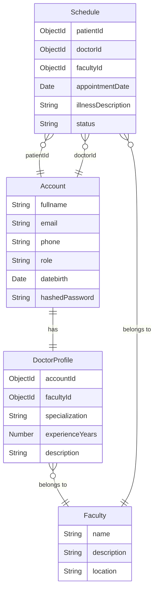
## APIs xác thực người dùng
### API Đăng Nhập — `/api/v1/auth/signin`
API **Đăng nhập (Sign-In)** cho phép người dùng xác thực bằng **email** và **mật khẩu**.  
Sau khi xác thực thành công, hệ thống tạo **Access Token** và **Refresh Token** dưới dạng **cookie bảo mật (HttpOnly)** để duy trì phiên đăng nhập an toàn.

---

**Phương thức & Đường dẫn**

**POST** `/api/v1/auth/signin`

---

**Dữ liệu yêu cầu**
| Trường | Kiểu dữ liệu | Bắt buộc | Mô tả |
|--------|---------------|----------|--------|
| `email` | string | Có | Địa chỉ email của người dùng |
| `password` | string | Có | Mật khẩu đăng nhập |

**Ví dụ request**
```json
{
  "email": "user@example.com",
  "password": "password123"
}
```

**Quy trình xử lý**

**1. Kiểm tra đầu vào**

Hệ thống kiểm tra xem email và password có được gửi lên hay không.

Nếu thiếu một trong hai → trả về mã lỗi 400 Bad Request.

**2. Xác thực tài khoản**

Kiểm tra định dạng email.

Truy vấn cơ sở dữ liệu (Account) theo địa chỉ email.

So sánh password người dùng gửi lên với hashedPassword trong cơ sở dữ liệu bằng bcrypt.

Nếu email không tồn tại hoặc mật khẩu sai → trả về 401 Unauthorized.

**3. Sinh token và thiết lập cookie**

Khi xác thực thành công, hệ thống:

Tạo Access Token (hiệu lực ~30 phút).

Tạo Refresh Token (hiệu lực ~7 ngày).

Lưu cả hai vào cookie HttpOnly để bảo mật (không thể truy cập qua JavaScript).

**4. Phản hồi cho client**

Trả về mã 200 OK kèm thông tin:
```json
{
  "message": "Login successful",
  "role": "user"
}
```
🍪 Cấu hình cookie
| Tên cookie     | Mục đích               | Hiệu lực | HttpOnly | Secure | SameSite |
| -------------- | ---------------------- | -------- | -------- | ------ | -------- |
| `accessToken`  | Token truy cập API     | 30 phút  | ✅        | ✅      | `none`   |
| `refreshToken` | Làm mới token truy cập | 7 ngày   | ✅        | ✅      | `none`   |

⚠️ Khi chạy ở production, cookie chỉ gửi qua HTTPS (secure: true).
🔑 Payload trong JWT
```
{
  "id": "665b7ad9240a3e8e7b0b8f1a",
  "email": "user@example.com",
  "role": "user"
}
```

**5. Các mã lỗi có thể gặp**
| Mã lỗi  | Nguyên nhân                      |
| ------- | -------------------------------- |
| **400** | Thiếu `email` hoặc `password`    |
| **401** | Email hoặc mật khẩu không hợp lệ |
| **500** | Lỗi máy chủ hoặc cơ sở dữ liệu   |

**6. Ghi chú bảo mật**

Không trả mật khẩu trong bất kỳ phản hồi nào.

Sử dụng HttpOnly cookies để chống tấn công XSS.

Sử dụng SameSite: "none" để giảm rủi ro CSRF.

Giới hạn thông tin lỗi nhằm tránh dò tìm tài khoản.

Mã hóa mật khẩu bằng bcrypt trước khi lưu trữ.

### API Đăng Ký Tài Khoản — `/api/v1/auth/signup`

**Mô tả tổng quan**
API **Đăng ký (Sign-up)** cho phép người dùng tạo tài khoản mới trong hệ thống.  
Hệ thống sẽ kiểm tra hợp lệ của các thông tin đầu vào (email, số điện thoại, mật khẩu, ngày sinh...)  
và lưu tài khoản vào cơ sở dữ liệu MongoDB nếu hợp lệ.

---

**Phương thức & Đường dẫn**
**POST** `/api/v1/auth/signup`

---

**Dữ liệu yêu cầu**
| Trường | Kiểu dữ liệu | Bắt buộc | Mô tả |
|--------|---------------|----------|--------|
| `fullname` | string | Có | Họ và tên người dùng |
| `email` | string | Có | Địa chỉ email (phải đúng định dạng) |
| `phone` | string | Có | Số điện thoại Việt Nam (bắt đầu bằng `0` hoặc `+84`) |
| `datebirth` | string / Date | Có | Ngày sinh (phải hợp lệ và ≥ 12 tuổi) |
| `password` | string | Có | Mật khẩu (ít nhất 6 ký tự) |

**Ví dụ request**
```json
{
  "fullname": "John Doe",
  "email": "john@example.com",
  "phone": "0912345678",
  "datebirth": "2000-01-01",
  "password": "securePass123"
}
```
**Quy trình xử lý**

**1. Kiểm tra dữ liệu đầu vào**

Đảm bảo tất cả các trường cần thiết (fullname, email, phone, datebirth, password) đều được gửi lên.

Xác thực định dạng email (example@domain.com).

Xác thực định dạng số điện thoại Việt Nam:

Hợp lệ: 0912345678, +84912345678

Không hợp lệ: 123456, 8499xxxxx

Kiểm tra độ dài mật khẩu ≥ 6 ký tự.

Kiểm tra ngày sinh hợp lệ và độ tuổi tối thiểu là 12.

Nếu bất kỳ điều kiện nào không thỏa mãn → trả về mã 400 Bad Request.

**2. Kiểm tra trùng lặp tài khoản**

Kiểm tra xem email đã tồn tại trong cơ sở dữ liệu hay chưa.
Nếu có → trả về lỗi 400 với thông báo "Email already exists".

Kiểm tra xem số điện thoại đã tồn tại hay chưa.
Nếu có → trả về lỗi 400 với thông báo "Phone number already exists".

**3. Xử lý tạo tài khoản**

Mật khẩu được băm (hash) bằng bcrypt trước khi lưu (tuyệt đối không lưu plaintext).

Tạo tài khoản mới trong collection Account:

```json
{
  "fullname": "John Doe",
  "email": "john@example.com",
  "phone": "0912345678",
  "datebirth": "2000-01-01",
  "hashedPassword": "<bcrypt_hash_here>",
  "role": "user"
}
```

**4. Phản hồi cho client**

Nếu tạo tài khoản thành công → trả về mã 201 Created:
```
{
  "message": "Account created successfully"
}
```
**5. Các mã lỗi có thể gặp**

| Mã lỗi  | Nguyên nhân                                   |
| ------- | --------------------------------------------- |
| **400** | Thiếu dữ liệu bắt buộc hoặc sai định dạng     |
| **400** | Email hoặc số điện thoại đã tồn tại           |
| **400** | Mật khẩu quá ngắn hoặc ngày sinh không hợp lệ |
| **500** | Lỗi máy chủ hoặc cơ sở dữ liệu                |

**6. Cấu trúc xử lý tổng quan**
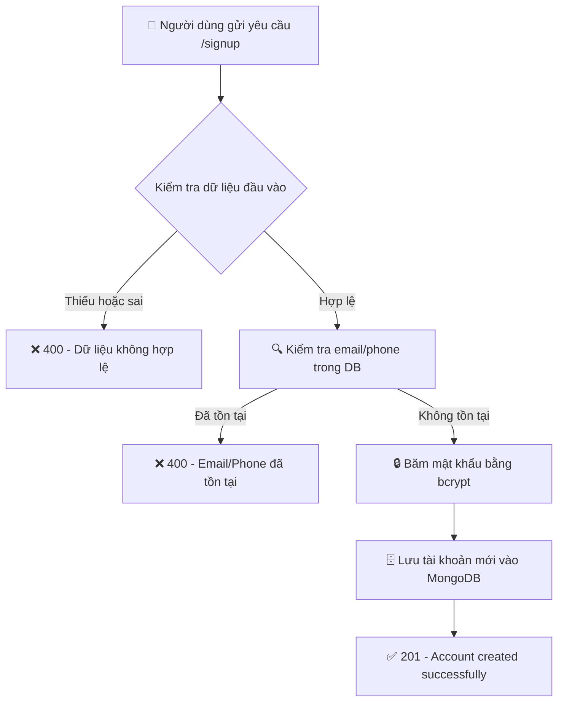

**7. Ghi chú bảo mật**

Mật khẩu không bao giờ được lưu hoặc trả về dưới dạng thuần văn bản.

Dữ liệu được chuẩn hóa (trim + lowercase) để tránh trùng lặp.

Giới hạn độ tuổi tối thiểu giúp ngăn việc đăng ký của trẻ vị thành niên.

Mọi lỗi được xử lý có kiểm soát để tránh rò rỉ thông tin nội bộ.

### API Đăng Xuất Tài Khoản - `/api/v1/auth/signout`
**Mô tả tổng quan**
API Đăng xuất (Sign-out) cho phép người dùng kết thúc phiên đăng nhập bằng cách xóa các token xác thực (accessToken và refreshToken) khỏi cookie.
Sau khi gọi API này, người dùng sẽ cần đăng nhập lại để tiếp tục truy cập các tài nguyên yêu cầu xác thực.

**Phương thức & Đường dẫn**

**POST** `/api/v1/auth/signout`

**Dữ liệu yêu cầu**

Không yêu cầu dữ liệu trong body.
API chỉ dựa vào cookie chứa accessToken và refreshToken để xác định phiên đăng nhập cần hủy.

**Ví dụ request:**
```
POST /api/v1/auth/signout
```

**Quy trình xử lý**

**1. Xác định cookie chứa token**

Kiểm tra cookie HTTP của request để tìm accessToken và refreshToken.

**2. Xóa token xác thực**

Nếu cookie tồn tại → xóa bằng phương thức res.clearCookie().

Token bị xóa ở phía client, giúp chấm dứt phiên đăng nhập.

**3. Trả phản hồi cho client**

Nếu xóa thành công → trả về mã 200 OK cùng thông báo đăng xuất thành công.

**Ví dụ phản hồi thành công**
```
{
  "message": "Logged out successfully"
}
```
**Các mã lỗi có thể gặp**

| Mã lỗi  | Nguyên nhân                                         |
| ------- | --------------------------------------------------- |
| **500** | Lỗi máy chủ khi thực hiện thao tác xóa cookie       |
| **401** | Người dùng chưa đăng nhập hoặc cookie không tồn tại |

**Cấu trúc xử lý tổng quan**
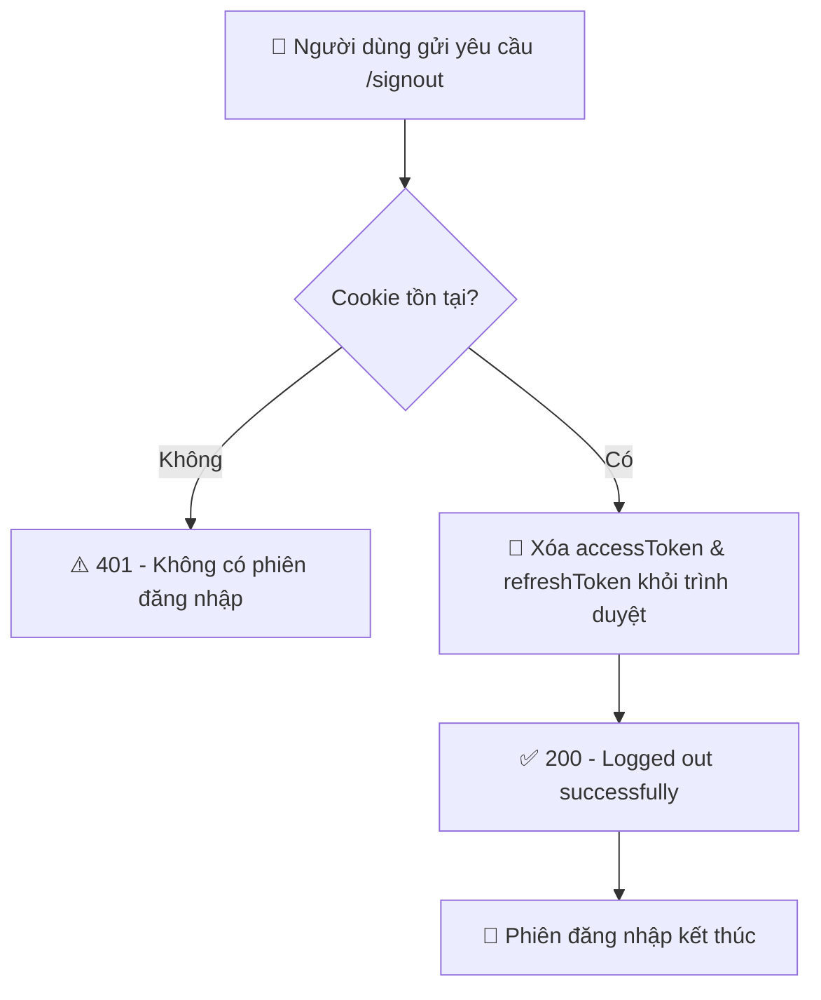

***Ghi chú bảo mật***

Cookie token được đặt với các tùy chọn bảo mật:

httpOnly: true → Chặn truy cập JavaScript, tránh XSS.

secure: true → Chỉ gửi qua HTTPS trong môi trường production.

sameSite: "lax" → Giảm rủi ro CSRF.

Token chỉ bị xóa phía client, không ảnh hưởng đến refreshToken lưu trong DB (nếu có).

Nên kết hợp với API refresh token để đảm bảo đồng bộ đăng xuất giữa client và server.

## APIs tương tác với tài khoản

### API Tạo Tài Khoản — `/api/v1/account/`

**Mô tả tổng quan**

API Tạo tài khoản (Create Account) cho phép Moderator, Admin hoặc Doctor có quyền truy cập tạo mới tài khoản người dùng khác trong hệ thống.

Yêu cầu bắt buộc có accessToken hợp lệ (được xác thực bởi middleware verifyAccessToken) và quyền hạn Moderator trở lên (kiểm tra bằng checkModeratorRole).

**Phương thức & Đường dẫn**

POST `/api/v1/account/`

**Dữ liệu yêu cầu**

| Trường      | Kiểu dữ liệu  | Bắt buộc | Mô tả                                                                               |
| ----------- | ------------- | -------- | ----------------------------------------------------------------------------------- |
| `fullname`  | string        | Có       | Họ và tên người dùng                                                                |
| `email`     | string        | Có       | Địa chỉ email hợp lệ ([example@domain.com](mailto:example@domain.com))              |
| `phone`     | string        | Có       | Số điện thoại Việt Nam (`0XXXXXXXXX` hoặc `+84XXXXXXXXX`)                           |
| `password`  | string        | Có       | Mật khẩu, tối thiểu **6 ký tự**                                                     |
| `datebirth` | string / Date | Có       | Ngày sinh hợp lệ, người dùng phải ≥ **12 tuổi**                                     |
| `role`      | string        | Không    | Quyền của tài khoản (`user`, `admin`, `doctor`, `moderator`) – mặc định là `"user"` |

**Ví dụ Request**
```json
{
  "fullname": "Nguyễn Văn A",
  "email": "nguyenvana@example.com",
  "phone": "0912345678",
  "password": "strongPass123",
  "datebirth": "2000-05-12",
  "role": "user"
}
```

**Quy trình xử lý**

**1. Kiểm tra xác thực & quyền hạn**

Middleware verifyAccessToken xác minh JWT token trong cookie.

Middleware checkModeratorRole đảm bảo chỉ Moderator/Admin mới được phép tạo tài khoản.

2. Kiểm tra dữ liệu đầu vào

Các trường bắt buộc: fullname, email, phone, password, datebirth.

Email phải hợp lệ theo regex.

Số điện thoại phải theo chuẩn Việt Nam:
Hợp lệ: 0912345678, +84912345678
Không hợp lệ: 123456, 8499xxxxxx

Mật khẩu ≥ 6 ký tự.

Ngày sinh hợp lệ, người dùng phải ít nhất 12 tuổi.

3. Kiểm tra trùng lặp tài khoản

Nếu email hoặc số điện thoại đã tồn tại trong MongoDB → trả về 400 Bad Request.

4. Xử lý tạo tài khoản

Mật khẩu được băm bằng bcrypt trước khi lưu.

Dữ liệu được chuẩn hóa (trim và lowercase).

Lưu vào collection Account:

```json
{
  "fullname": "Nguyễn Văn A",
  "email": "nguyenvana@example.com",
  "phone": "0912345678",
  "role": "user",
  "datebirth": "2000-05-12T00:00:00Z",
  "hashedPassword": "$2b$10$..."
}
```

5. Phản hồi cho client

Nếu tạo tài khoản thành công → HTTP 201 Created
```json
{
  "message": "Account created successfully"
}
```

**Các mã lỗi có thể gặp**

| Mã lỗi  | Nguyên nhân                                            |
| ------- | ------------------------------------------------------ |
| **400** | Thiếu dữ liệu bắt buộc hoặc định dạng không hợp lệ     |
| **400** | Email hoặc số điện thoại đã tồn tại                    |
| **400** | Mật khẩu quá ngắn hoặc ngày sinh không hợp lệ          |
| **401** | Không có quyền truy cập (không phải Moderator trở lên) |
| **500** | Lỗi máy chủ hoặc lỗi MongoDB                           |

**Sơ đồ luồng xử lý**

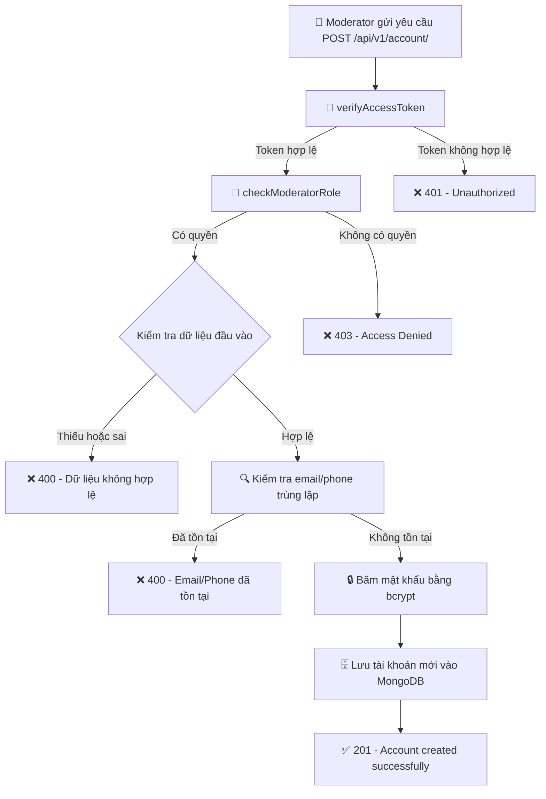

**Ghi chú bảo mật**

Mật khẩu không bao giờ được lưu hoặc trả về dưới dạng thuần văn bản.

Tất cả dữ liệu được chuẩn hóa để tránh trùng lặp không mong muốn.

Chỉ Moderator mới có quyền sử dụng API này.

Middleware bảo vệ tài nguyên ngăn truy cập trái phép qua cookie giả mạo.

### API Cập nhật tài khoản người dùng - `PUT /accounts/:idOrEmail`

**Mô tả tổng quan**

API cho phép cập nhật thông tin tài khoản người dùng dựa trên _id hoặc email.
Chỉ có Moderator (hoặc cấp cao hơn) mới có quyền truy cập endpoint này.
Middleware bảo vệ gồm:

verifyAccessToken — kiểm tra token hợp lệ.

checkModeratorRole — xác nhận người dùng có vai trò "moderator".

**Phương thức & Đường dẫn**

PUT `/api/v1/account/:idOrEmail`

**Dữ liệu yêu cầu**

| Trường      | Kiểu dữ liệu  | Bắt buộc | Mô tả                                                |
| ----------- | ------------- | -------- | ---------------------------------------------------- |
| `idOrEmail` | string (URL)  | Có       | `_id` hoặc `email` của tài khoản cần cập nhật        |
| `fullname`  | string        | Không    | Họ tên người dùng mới                                |
| `email`     | string        | Không    | Email mới, phải duy nhất trong hệ thống              |
| `phone`     | string        | Không    | Số điện thoại mới, phải duy nhất trong hệ thống      |
| `password`  | string        | Không    | Mật khẩu mới, sẽ được tự động băm bằng **bcrypt**    |
| `role`      | string        | Không    | Vai trò mới (`user`, `admin`, `doctor`, `moderator`) |
| `datebirth` | string / Date | Không    | Ngày sinh mới (định dạng hợp lệ ISO hoặc chuỗi ngày) |

**Ví dụ Request**
```
PUT /api/v1/account/user@example.com
Cookie: accessToken=eyJhbGciOi...

{
  "fullname": "Nguyễn Văn A",
  "phone": "0912345678",
  "password": "newSecurePass123",
  "role": "doctor"
}
```

**Quy trình xử lý**

**1. Kiểm tra xác thực & quyền hạn**

Middleware verifyAccessToken xác minh tính hợp lệ của JWT token trong cookie.

Middleware checkModeratorRole đảm bảo chỉ tài khoản có quyền Moderator trở lên mới được phép cập nhật người khác.

**2. Xác định tài khoản mục tiêu**

Hệ thống đọc tham số :idOrEmail từ URL.

Nếu có ký tự @, hệ thống sẽ hiểu là email, ngược lại là _id.

Nếu không tìm thấy tài khoản tương ứng → trả về 404 - Account not found.

**3. Kiểm tra trùng lặp dữ liệu**

Nếu email hoặc số điện thoại mới trùng với tài khoản khác → trả về 400 - Email/Phone already exists.

**4. Xử lý cập nhật**

Các trường hợp được cung cấp sẽ được cập nhật tương ứng:

Mật khẩu → băm bằng bcrypt

Email, số điện thoại → chuyển về chữ thường, cắt khoảng trắng

Ngày sinh → chuẩn hóa dạng Date hợp lệ

Các giá trị không có trong body sẽ được bỏ qua (giữ nguyên dữ liệu cũ).

**5. Lưu vào MongoDB**

Dữ liệu sau khi xử lý sẽ được ghi đè lên tài khoản tương ứng trong collection Account.

Nếu cập nhật thành công → phản hồi trạng thái 200 OK.

**Phản hồi thành công**
```
{
  "message": "Account updated successfully"
}
```

**Các mã lỗi có thể gặp**

| Mã lỗi  | Nguyên nhân                                              |
| ------- | -------------------------------------------------------- |
| **400** | Email hoặc số điện thoại đã tồn tại                      |
| **401** | Không có hoặc accessToken không hợp lệ                   |
| **403** | Người dùng không có quyền (không phải Moderator trở lên) |
| **404** | Không tìm thấy tài khoản cần cập nhật                    |
| **500** | Lỗi hệ thống hoặc lỗi khi truy cập cơ sở dữ liệu         |

**Sơ đồ luồng xử lý**
```mermaid
flowchart TD
    A[👮 Moderator gửi yêu cầu PUT /api/v1/account/:idOrEmail] --> B[🔐 verifyAccessToken]
    B -->|Token hợp lệ| C[🧩 checkModeratorRole]
    B -->|Token không hợp lệ| X1[❌ 401 - Unauthorized]
    C -->|Có quyền| D[📥 Nhận tham số idOrEmail và body]
    C -->|Không có quyền| X2[❌ 403 - Access Denied]
    D --> E[🔍 Tìm tài khoản trong MongoDB]
    E -->|Không tồn tại| X3[❌ 404 - Account not found]
    E -->|Tồn tại| F[🧠 Kiểm tra trùng email/phone]
    F -->|Trùng| X4[❌ 400 - Email/Phone đã tồn tại]
    F -->|Không trùng| G[🔒 Băm mật khẩu (nếu có)]
    G --> H[🗄️ Cập nhật tài khoản trong MongoDB]
    H --> I[✅ 200 - Account updated successfully]
```

**Ghi chú bảo mật**

- Mật khẩu không bao giờ được lưu hoặc phản hồi ở dạng thuần văn bản.

- Dữ liệu người dùng được chuẩn hóa (trim, lowercase) để tránh trùng lặp.

- Middleware bảo vệ tài nguyên giúp ngăn truy cập trái phép qua cookie giả mạo.

- Chỉ những người dùng có vai trò Moderator hoặc cao hơn mới có quyền cập nhật tài khoản.

### API Lấy Danh Sách Tài Khoản — `/api/v1/account/`

**Mô tả tổng quan**

API Lấy danh sách tài khoản (Get Accounts) cho phép Moderator, Admin hoặc Doctor có quyền xem danh sách người dùng trong hệ thống.
Kết quả được hỗ trợ phân trang (pagination), sắp xếp theo ngày tạo mới nhất → cũ nhất.

Yêu cầu bắt buộc có accessToken hợp lệ (kiểm tra bằng verifyAccessToken) và quyền hạn Moderator trở lên (kiểm tra bằng checkModeratorRole).

**Phương thức & Đường dẫn**

GET `/api/v1/account/`

**Tham số truy vấn (Query Parameters)**

| Tham số | Kiểu dữ liệu | Bắt buộc | Mô tả                                         |
| ------- | ------------ | -------- | --------------------------------------------- |
| `page`  | number       | Không    | Số trang cần lấy (mặc định: `1`)              |
| `limit` | number       | Không    | Số lượng tài khoản mỗi trang (mặc định: `10`) |

**Ví dụ Request**

```json
GET /api/v1/account?page=2&limit=5
Cookie: accessToken=eyJhbGciOi...
```

```json
{
  "accounts": [
    {
      "_id": "66e8e8fca914a0ff7e9f0001",
      "fullname": "Nguyễn Văn A",
      "email": "nguyenvana@example.com",
      "phone": "0912345678",
      "role": "user",
      "datebirth": "2000-05-12T00:00:00Z",
      "createdAt": "2025-10-01T09:30:00Z"
    },
    {
      "_id": "66e8e8fca914a0ff7e9f0002",
      "fullname": "Trần Thị B",
      "email": "tranthib@example.com",
      "role": "doctor",
      "createdAt": "2025-09-25T13:45:00Z"
    }
  ],
  "total": 42,
  "page": 2,
  "totalPages": 9
}
```

**Quy trình xử lý**

**1. Kiểm tra xác thực & quyền hạn**

Middleware verifyAccessToken xác minh token JWT hợp lệ.

Middleware checkModeratorRole đảm bảo người gửi yêu cầu có quyền Moderator trở lên.

Nếu không có quyền hoặc token không hợp lệ → trả về lỗi 401/403.

**2. Phân tích tham số truy vấn**

page và limit được đọc từ req.query.

Nếu không có → mặc định page = 1, limit = 10.

**3. Lấy dữ liệu từ cơ sở dữ liệu**

Tính số lượng cần bỏ qua:
skip = (page - 1) * limit

Lấy danh sách tài khoản theo thứ tự mới nhất → cũ nhất bằng sort({ createdAt: -1 }).

Đồng thời đếm tổng số lượng tài khoản (countDocuments()).

**4. Trả về kết quả phân trang**

Dữ liệu trả về gồm:

accounts: danh sách tài khoản

total: tổng số tài khoản

page: trang hiện tại

totalPages: tổng số trang

```json
{
  "accounts": [...],
  "total": 42,
  "page": 1,
  "totalPages": 5
}
```

**Các mã lỗi có thể gặp**

| Mã lỗi  | Nguyên nhân                                            |
| ------- | ------------------------------------------------------ |
| **401** | Thiếu hoặc accessToken không hợp lệ                    |
| **403** | Không có quyền truy cập (không phải Moderator trở lên) |
| **500** | Lỗi hệ thống hoặc lỗi MongoDB                          |

**Sơ đồ luồng xử lý**

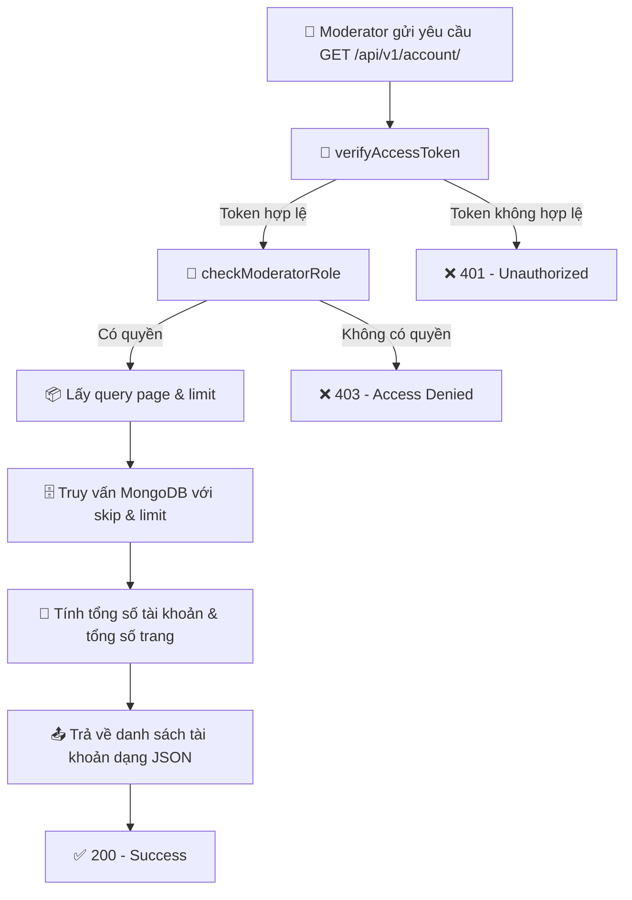

**Ghi chú kỹ thuật**

API chỉ hiển thị dữ liệu tài khoản, không bao gồm mật khẩu hoặc hashedPassword.

Dữ liệu được sắp xếp theo thời gian tạo (createdAt) mới nhất.

Thích hợp để sử dụng trong bảng quản trị hoặc danh sách người dùng hệ thống.

### API Xóa Tài Khoản Người Dùng – `DELETE /accounts`

**Mô tả tổng quan**

API cho phép Moderator (hoặc cấp cao hơn) xóa một tài khoản người dùng khỏi hệ thống dựa trên _id.
Đây là hành động nguy hiểm, chỉ nên được sử dụng bởi người quản trị có quyền cao.

API được bảo vệ bởi 2 middleware:

verifyAccessToken — Xác minh access token hợp lệ từ cookie người dùng.

checkModeratorRole — Đảm bảo người dùng có vai trò "moderator" trở lên.

**Phương thức & Đường dẫn**

```
DELETE /api/v1/accounts
```

**Dữ liệu yêu cầu**

| Trường      | Kiểu dữ liệu | Bắt buộc | Mô tả                                     |
| ----------- | ------------ | -------- | ----------------------------------------- |
| `accountId` | string       | ✅        | `_id` của tài khoản cần xóa trong MongoDB |

**Ví dụ Request**

```
DELETE /api/v1/accounts
Cookie: accessToken=eyJhbGciOi...

{
  "accountId": "670f2a8c1b9c5f0012345678"
}
```

**Quy trình xử lý**

**1. Kiểm tra xác thực & quyền hạn**

Middleware verifyAccessToken kiểm tra JWT trong cookie.

Nếu không có hoặc token không hợp lệ → 401 Unauthorized.

Middleware checkModeratorRole xác minh người gọi API có vai trò "moderator" trở lên.

Nếu không đủ quyền → 403 Access Denied.

**2. Xác nhận dữ liệu đầu vào**

Nếu thiếu trường accountId trong body → 400 accountId is required.

**3. Kiểm tra sự tồn tại của tài khoản**

Dựa trên accountId, hệ thống tìm kiếm trong MongoDB.

Nếu không tồn tại → 404 Account not found.

**4. Tiến hành xóa**

Nếu tài khoản tồn tại, tiến hành xóa bằng Account.deleteOne({ _id: accountId }).

Nếu thao tác thành công → trả về 200 OK.

**Phản hồi thành công**
```
{
  "message": "Account deleted successfully"
}
```

**Các mã lỗi có thể gặp**

| Mã lỗi  | Nguyên nhân                                        |
| ------- | -------------------------------------------------- |
| **400** | Thiếu trường `accountId` hoặc dữ liệu không hợp lệ |
| **401** | Token truy cập không hợp lệ hoặc đã hết hạn        |
| **403** | Người dùng không có quyền xóa tài khoản            |
| **404** | Không tìm thấy tài khoản cần xóa                   |
| **500** | Lỗi hệ thống hoặc lỗi khi truy cập cơ sở dữ liệu   |

Sơ đồ luồng xử lý

```mermaid
flowchart TD
    A[🧑‍💼 Moderator gửi yêu cầu DELETE /api/v1/accounts] --> B[🔐 verifyAccessToken]
    B -->|Token hợp lệ| C[🧩 checkModeratorRole]
    B -->|Token không hợp lệ| X1[❌ 401 - Unauthorized]
    C -->|Có quyền| D[📥 Nhận dữ liệu accountId từ body]
    C -->|Không có quyền| X2[❌ 403 - Access Denied]
    D --> E{Tồn tại accountId?}
    E -->|Không| X3[❌ 400 - accountId is required]
    E -->|Có| F[🔍 Tìm tài khoản trong MongoDB]
    F -->|Không tồn tại| X4[❌ 404 - Account not found]
    F -->|Tồn tại| G[🗑️ Xóa tài khoản bằng deleteOne()]
    G --> H[✅ 200 - Account deleted successfully]
```

**Ghi chú bảo mật**

API chỉ dành cho Moderator hoặc cấp cao hơn (Admin).

Token được xác minh thông qua JWT và lưu trong HTTP-only cookie, giúp ngăn đánh cắp token từ trình duyệt.

Không có thông tin nhạy cảm nào được trả về trong phản hồi.

Mọi yêu cầu không hợp lệ hoặc cố truy cập trái phép đều bị từ chối với mã lỗi thích hợp.

### API Thống Kê Tài Khoản Người Dùng – `GET /accounts/stats`

**Mô tả tổng quan**

API này cho phép Admin lấy thống kê tổng quan về số lượng tài khoản trong hệ thống, được phân loại theo vai trò (user, admin, doctor, moderator).
Đây là endpoint dùng trong báo cáo quản trị hoặc dashboard nội bộ.

API được bảo vệ bởi 2 middleware quan trọng:

verifyAccessToken — Xác minh token truy cập (JWT) hợp lệ.

checkAdminRole — Đảm bảo chỉ Admin mới có quyền truy cập endpoint này.

**Phương thức & Đường dẫn**
```
GET /api/v1/accounts/stats
```

**Yêu cầu xác thực**
| Middleware          | Chức năng                                 |
| ------------------- | ----------------------------------------- |
| `verifyAccessToken` | Kiểm tra JWT token trong cookie           |
| `checkAdminRole`    | Chỉ cho phép tài khoản có vai trò `admin` |

**Phản hồi thành công**
| Trường      | Kiểu dữ liệu | Mô tả                                     |
| ----------- | ------------ | ----------------------------------------- |
| `user`      | number       | Số lượng tài khoản có vai trò `user`      |
| `admin`     | number       | Số lượng tài khoản có vai trò `admin`     |
| `doctor`    | number       | Số lượng tài khoản có vai trò `doctor`    |
| `moderator` | number       | Số lượng tài khoản có vai trò `moderator` |

**Ví dụ Request**
```
GET /api/v1/accounts/stats
Cookie: accessToken=eyJhbGciOi...
```

**Ví dụ Response**
```
{
  "message": "Account statistics retrieved successfully",
  "data": {
    "user": 120,
    "admin": 3,
    "doctor": 12,
    "moderator": 6
  }
}
```

**Quy trình xử lý**

**1. Xác thực & phân quyền**

verifyAccessToken xác minh accessToken có hợp lệ hay không.

Nếu không hợp lệ → 401 Unauthorized.

checkAdminRole đảm bảo chỉ tài khoản có vai trò "admin" mới được truy cập.

Nếu không có quyền → 403 Access Denied.

**2. Thực hiện truy vấn thống kê**

Sử dụng MongoDB aggregation ($group) để đếm số lượng tài khoản cho từng vai trò.

Các vai trò không xuất hiện trong DB sẽ mặc định có giá trị 0.

**3. Trả kết quả cho client**

Nếu thành công → HTTP 200 OK với dữ liệu thống kê.

Nếu có lỗi trong quá trình truy vấn → HTTP 500 Internal Server Error.

**Các mã lỗi có thể gặp**

| Mã lỗi  | Nguyên nhân                                            |
| ------- | ------------------------------------------------------ |
| **401** | Token không hợp lệ hoặc đã hết hạn                     |
| **403** | Người dùng không có quyền truy cập (không phải Admin)  |
| **500** | Lỗi hệ thống hoặc lỗi trong quá trình truy vấn MongoDB |

**Sơ đồ luồng xử lý**

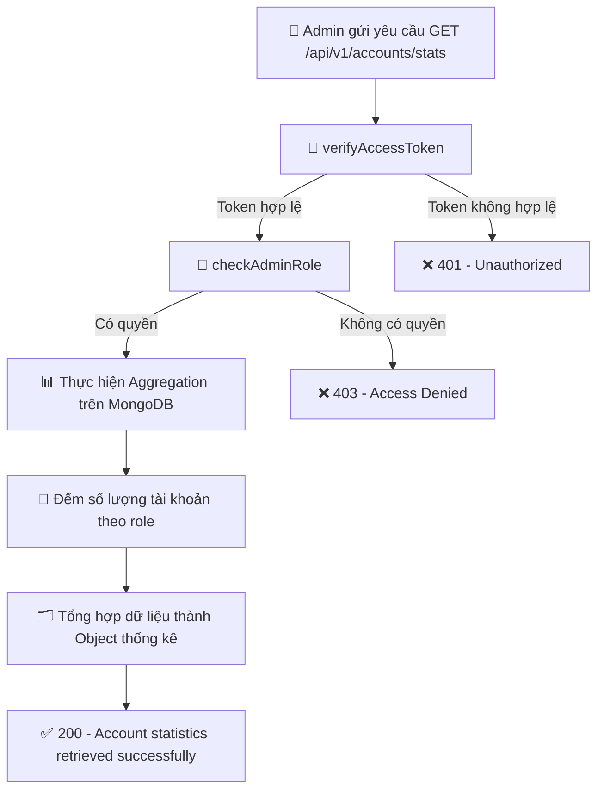

**Ghi chú bảo mật**

Chỉ Admin có thể gọi endpoint này.

Token được xác minh thông qua JWT trong HTTP-only cookie.

API không tiết lộ bất kỳ thông tin cá nhân nào — chỉ trả về số lượng.

Dữ liệu được lấy trực tiếp từ MongoDB, đảm bảo độ chính xác cao.

## APIs tương tác với khoa khám bệnh

### API Tạo Khoa – POST `/api/v1/faculties`

**Mô tả tổng quan**

API này cho phép Moderator tạo mới một khoa (faculty) trong hệ thống — bao gồm tên, mô tả và vị trí.
Đây là endpoint được dùng trong dashboard quản trị để thêm mới các khoa y học hoặc đơn vị chuyên môn.

API được bảo vệ bởi 2 middleware:

verifyAccessToken — Xác minh JWT access token hợp lệ.

checkModeratorRole — Đảm bảo chỉ Moderator mới có quyền thêm mới khoa.

**Phương thức & Đường dẫn**
```
POST /api/v1/faculties
```

**Yêu cầu xác thực**
| Middleware           | Chức năng                                     |
| -------------------- | --------------------------------------------- |
| `verifyAccessToken`  | Kiểm tra JWT token trong cookie               |
| `checkModeratorRole` | Chỉ cho phép tài khoản có vai trò `moderator` |

**Tham số đầu vào**
| Trường        | Kiểu dữ liệu | Bắt buộc | Mô tả                        |
| ------------- | ------------ | -------- | ---------------------------- |
| `name`        | string       | ✅        | Tên của khoa                 |
| `description` | string       | ❌        | Mô tả chi tiết về khoa       |
| `location`    | string       | ❌        | Vị trí khoa trong cơ sở y tế |

**Phản hồi thành công**
| Trường    | Kiểu dữ liệu | Mô tả                               |
| --------- | ------------ | ----------------------------------- |
| `message` | string       | Thông báo tạo thành công            |
| `faculty` | object       | Thông tin chi tiết của khoa vừa tạo |

**Ví dụ Request**
```
POST /api/v1/faculties
Cookie: accessToken=eyJhbGciOi...

{
  "name": "Răng Hàm Mặt",
  "description": "Chuyên điều trị răng miệng và hàm mặt.",
  "location": "Tầng 3, Bệnh viện Trung Ương"
}
```

**Ví dụ Response**
```
{
  "message": "Faculty created successfully",
  "faculty": {
    "_id": "671a4b9ef1...",
    "name": "Răng Hàm Mặt",
    "description": "Chuyên điều trị răng miệng và hàm mặt.",
    "location": "Tầng 3, Bệnh viện Trung Ương"
  }
}
```

**Quy trình xử lý**

**1. Xác thực & phân quyền**

verifyAccessToken kiểm tra JWT token có hợp lệ hay không.
→ Nếu không hợp lệ → trả về 401 Unauthorized.

checkModeratorRole xác định tài khoản có vai trò moderator.
→ Nếu không phải → trả về 403 Access Denied.

**2. Kiểm tra dữ liệu đầu vào**

Trường name là bắt buộc.
→ Nếu thiếu, trả về 400 Faculty name is required.

**3. Kiểm tra trùng tên trong cơ sở dữ liệu**

Nếu Faculty với cùng tên đã tồn tại → trả về 400 Faculty already exists.

**4. Tạo mới Faculty**

Nếu hợp lệ → tạo mới đối tượng Faculty và lưu vào MongoDB.

Nếu quá trình lưu thất bại → trả về 500 Failed to create faculty.

**5. Trả phản hồi cho client**

Thành công → HTTP 201 Created kèm thông tin khoa.

Thất bại → Trả lỗi tương ứng theo giai đoạn.

**Các mã lỗi có thể gặp**

| Mã lỗi  | Nguyên nhân                                       |
| ------- | ------------------------------------------------- |
| **400** | Thiếu tên khoa hoặc trùng tên với khoa khác       |
| **401** | Token không hợp lệ hoặc hết hạn                   |
| **403** | Người dùng không có quyền (không phải Moderator)  |
| **500** | Lỗi hệ thống hoặc lỗi khi ghi dữ liệu vào MongoDB |

Sơ đồ luồng xử lý
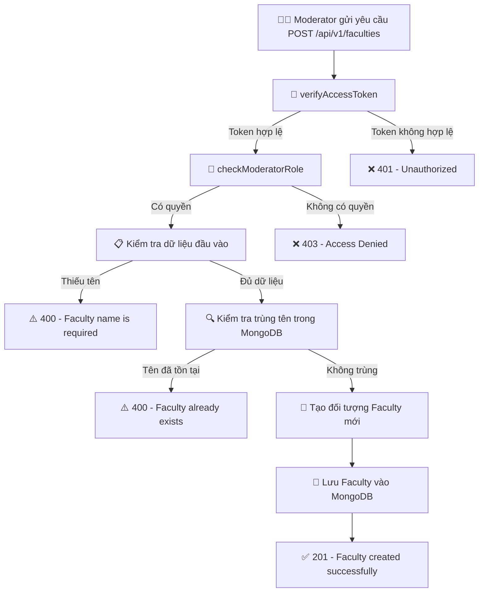

**Ghi chú bảo mật**

Chỉ Moderator có thể gọi endpoint này.

Token được xác minh bằng JWT lưu trong HTTP-only cookie.

API không tiết lộ thông tin nhạy cảm, chỉ ghi nhận dữ liệu cần thiết.

Dữ liệu được xác thực & ghi trực tiếp vào MongoDB, đảm bảo tính toàn vẹn.

### API Lấy Danh Sách Khoa – GET `/api/v1/faculties`
**Mô tả tổng quan**

API này cho phép Moderator hoặc người quản trị lấy danh sách các khoa (faculties) trong hệ thống, hỗ trợ phân trang (pagination) để tải dữ liệu theo từng trang — tối ưu cho hiển thị dạng lazy-loading trên dashboard.

API được bảo vệ bởi 2 middleware:

verifyAccessToken — Xác minh JWT token hợp lệ.

checkModeratorRole — Chỉ cho phép Moderator trở lên truy cập dữ liệu khoa.

**Phương thức & Đường dẫn**

```json
GET /api/v1/faculties?page=1&limit=10
```

**Yêu cầu xác thực**
| Middleware           | Chức năng                                        |
| -------------------- | ------------------------------------------------ |
| `verifyAccessToken`  | Kiểm tra JWT token trong cookie                  |
| `checkModeratorRole` | Đảm bảo tài khoản có vai trò `moderator` trở lên |

**Tham số truy vấn (Query Params)**
| Trường  | Kiểu dữ liệu | Bắt buộc | Mô tả                                      |
| ------- | ------------ | -------- | ------------------------------------------ |
| `page`  | number       | ❌        | Trang hiện tại (mặc định = 1)              |
| `limit` | number       | ❌        | Số lượng bản ghi mỗi trang (mặc định = 10) |

**Phản hồi thành công**
| Trường                   | Kiểu dữ liệu | Mô tả                              |
| ------------------------ | ------------ | ---------------------------------- |
| `message`                | string       | Thông báo lấy dữ liệu thành công   |
| `faculties`              | array        | Danh sách khoa trên trang hiện tại |
| `pagination`             | object       | Thông tin phân trang chi tiết      |
| `pagination.total`       | number       | Tổng số khoa trong hệ thống        |
| `pagination.totalPages`  | number       | Tổng số trang dữ liệu              |
| `pagination.currentPage` | number       | Trang hiện tại                     |
| `pagination.limit`       | number       | Số bản ghi tối đa mỗi trang        |
| `pagination.hasNextPage` | boolean      | Có trang tiếp theo không           |
| `pagination.hasPrevPage` | boolean      | Có trang trước đó không            |

**Ví dụ Request**
```
GET /api/v1/faculties?page=2&limit=5
Cookie: accessToken=eyJhbGciOi...
```

**Ví dụ Response**
```
{
  "message": "Faculties fetched successfully",
  "faculties": [
    {
      "_id": "67201abf7f...",
      "name": "Răng Hàm Mặt",
      "description": "Chuyên điều trị răng miệng và hàm mặt.",
      "location": "Tầng 3, Bệnh viện Trung Ương"
    },
    {
      "_id": "67201abf7a...",
      "name": "Da Liễu",
      "description": "Điều trị các bệnh về da.",
      "location": "Tầng 2"
    }
  ],
  "pagination": {
    "total": 25,
    "totalPages": 5,
    "currentPage": 2,
    "limit": 5,
    "hasNextPage": true,
    "hasPrevPage": true
  }
}
```

**Quy trình xử lý**

**1. Xác thực & phân quyền**

Middleware verifyAccessToken kiểm tra token có hợp lệ.
→ Nếu không hợp lệ → 401 Unauthorized.

Middleware checkModeratorRole đảm bảo người dùng có quyền phù hợp.
→ Nếu không phải Moderator → 403 Access Denied.

**2. Nhận tham số phân trang từ query**

page và limit được lấy từ URL (/faculties?page=1&limit=10).

Nếu không truyền → dùng mặc định page = 1, limit = 10.

**3. Truy vấn cơ sở dữ liệu MongoDB**

Thực hiện tìm kiếm theo skip và limit với .sort({ createdAt: -1 }).

Đồng thời đếm tổng số bản ghi bằng countDocuments().

**4. Xây dựng đối tượng phân trang**

Tính totalPages, hasNextPage, hasPrevPage dựa trên tổng số dữ liệu.

**5. Trả kết quả cho client**

Thành công → HTTP 200 OK kèm danh sách và thông tin phân trang.

Nếu lỗi → HTTP 500 Internal Server Error.

**Các mã lỗi có thể gặp**
| Mã lỗi  | Nguyên nhân                                      |
| ------- | ------------------------------------------------ |
| **401** | Token không hợp lệ hoặc hết hạn                  |
| **403** | Người dùng không có quyền (không phải Moderator) |
| **400** | Lỗi truy vấn hoặc tham số không hợp lệ           |
| **500** | Lỗi hệ thống hoặc lỗi khi truy xuất MongoDB      |

Sơ đồ luồng xử lý
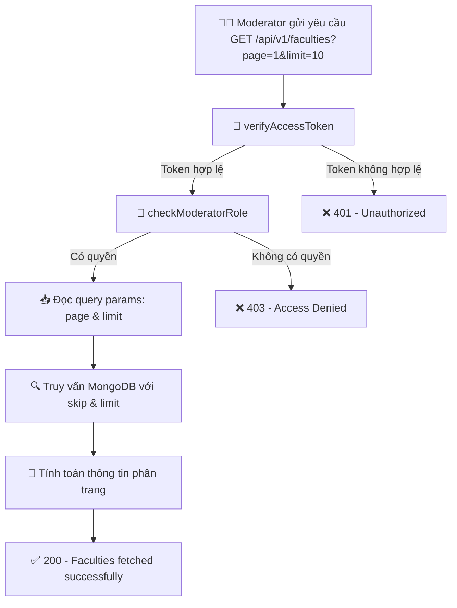

**Ghi chú bảo mật**

Endpoint này chỉ cho phép Moderator trở lên truy cập.

Token JWT được xác thực qua HTTP-only cookie để ngăn đánh cắp token.

Dữ liệu trả về chỉ gồm thông tin khoa — không chứa dữ liệu nhạy cảm.

Truy vấn được tối ưu bằng Promise.all() để tăng tốc độ phản hồi.

### API Cập Nhật Khoa – PUT `/api/v1/faculties/:id`
**Mô tả tổng quan**

API này cho phép Moderator hoặc Admin cập nhật thông tin của một khoa cụ thể trong hệ thống dựa trên facultyId.
Endpoint này được bảo vệ bởi 2 middleware quan trọng:

verifyAccessToken — Xác minh JWT token hợp lệ.

checkModeratorRole — Chỉ cho phép người có quyền moderator trở lên thực hiện chỉnh sửa.

**Phương thức & Đường dẫn**
```
PUT /api/v1/faculties/:id
```

**Yêu cầu xác thực**
| Middleware           | Chức năng                                         |
| -------------------- | ------------------------------------------------- |
| `verifyAccessToken`  | Kiểm tra và giải mã token JWT từ cookie           |
| `checkModeratorRole` | Xác minh quyền, chỉ cho phép moderator hoặc admin |


**Tham số đường dẫn (Path Params)**
```
| Trường | Kiểu dữ liệu | Bắt buộc | Mô tả                    |
| ------ | ------------ | -------- | ------------------------ |
| `id`   | string       | ✅        | ID của khoa cần cập nhật |
```

**Dữ liệu yêu cầu (Request Body)**
| Trường        | Kiểu dữ liệu | Bắt buộc | Mô tả                            |
| ------------- | ------------ | -------- | -------------------------------- |
| `name`        | string       | ❌        | Tên khoa mới (nếu muốn cập nhật) |
| `description` | string       | ❌        | Mô tả chi tiết về khoa           |
| `location`    | string       | ❌        | Vị trí của khoa trong cơ sở y tế |

**Ví dụ Request**
```
PUT /api/v1/faculties/6715f3b4f2b38b001f4cba9e
Cookie: accessToken=eyJhbGciOi...
Content-Type: application/json

{
  "name": "Khoa Nội Tim Mạch",
  "description": "Chuyên điều trị các bệnh lý về tim mạch",
  "location": "Tầng 5"
}
```

**Phản hồi thành công**

| Trường                | Kiểu dữ liệu | Mô tả                         |
| --------------------- | ------------ | ----------------------------- |
| `message`             | string       | Thông báo cập nhật thành công |
| `faculty`             | object       | Dữ liệu khoa sau khi cập nhật |
| `faculty._id`         | string       | ID của khoa                   |
| `faculty.name`        | string       | Tên khoa                      |
| `faculty.description` | string       | Mô tả của khoa                |
| `faculty.location`    | string       | Vị trí khoa                   |
| `faculty.updatedAt`   | string       | Thời gian cập nhật gần nhất   |

**Ví dụ Response**

```
{
  "message": "Faculty updated successfully",
  "faculty": {
    "_id": "6715f3b4f2b38b001f4cba9e",
    "name": "Khoa Nội Tim Mạch",
    "description": "Chuyên điều trị các bệnh lý về tim mạch",
    "location": "Tầng 5",
    "updatedAt": "2025-10-20T02:30:00.000Z"
  }
}
```

**Quy trình xử lý**

**1. Xác thực quyền truy cập**

verifyAccessToken kiểm tra token JWT trong cookie.

checkModeratorRole xác nhận người dùng có quyền hợp lệ.

**2. Lấy tham số id và dữ liệu cần cập nhật từ req.body.**

**3. Gọi hàm updateFacultyService để cập nhật trong MongoDB:**

Nếu không tìm thấy khoa → báo lỗi “Faculty not found”.

Nếu cập nhật thành công → trả về thông tin mới nhất của khoa.

**4. Trả phản hồi JSON**

Thành công → 200 OK.

Lỗi → 500 Internal Server Error hoặc mã lỗi tương ứng.

**Các mã lỗi có thể gặp**
| Mã lỗi  | Nguyên nhân                                            |
| ------- | ------------------------------------------------------ |
| **400** | ID không hợp lệ hoặc không truyền đủ dữ liệu           |
| **401** | Token không hợp lệ hoặc hết hạn                        |
| **403** | Người dùng không có quyền (không phải Moderator/Admin) |
| **404** | Không tìm thấy khoa cần cập nhật                       |
| **500** | Lỗi truy vấn hoặc lỗi hệ thống                         |

**Sơ đồ luồng xử lý**
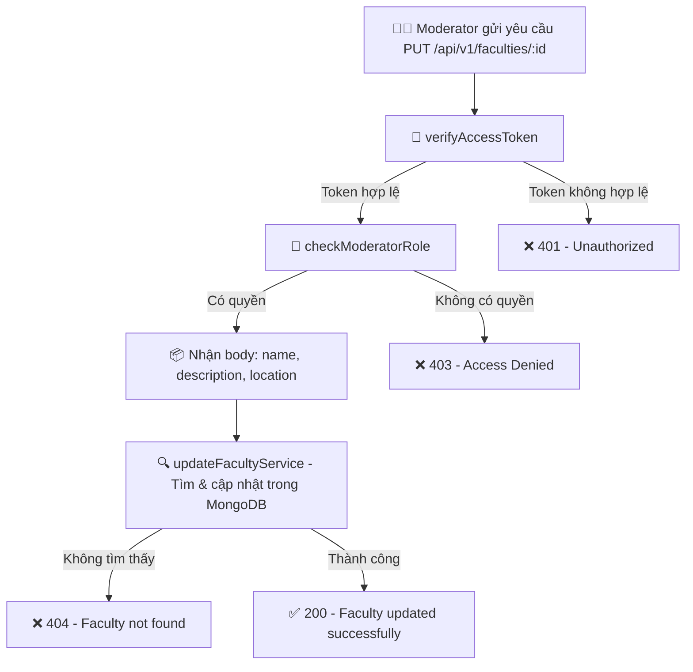

**Ghi chú bảo mật**

Chỉ người có quyền Moderator hoặc Admin mới được phép chỉnh sửa.

Xác thực JWT qua HTTP-only cookie, ngăn chặn đánh cắp token.

Dữ liệu đầu vào được kiểm tra bằng runValidators của Mongoose.

Không cho phép sửa các trường nhạy cảm (như _id, createdAt, v.v.).

### API Xóa Khoa – DELETE `/api/v1/faculties/:id`
**Mô tả tổng quan**

API này cho phép Moderator hoặc Admin xóa một khoa (faculty) trong hệ thống dựa trên facultyId.
Endpoint được bảo vệ bằng 2 middleware:

verifyAccessToken — Xác minh JWT token hợp lệ.

checkModeratorRole — Chỉ cho phép người có quyền Moderator trở lên thực hiện xóa.

**Phương thức & Đường dẫn**
```
DELETE /api/v1/faculties/:id
```

**Yêu cầu xác thực**
| Middleware           | Chức năng                                         |
| -------------------- | ------------------------------------------------- |
| `verifyAccessToken`  | Kiểm tra và giải mã token JWT từ cookie           |
| `checkModeratorRole` | Xác minh quyền, chỉ cho phép moderator hoặc admin |

**Tham số đường dẫn (Path Params)**
| Trường | Kiểu dữ liệu | Bắt buộc | Mô tả               |
| ------ | ------------ | -------- | ------------------- |
| `id`   | string       | ✅        | ID của khoa cần xóa |

**Ví dụ Request**
```
DELETE /api/v1/faculties/6715f3b4f2b38b001f4cba9e
Cookie: accessToken=eyJhbGciOi...
```

**Phản hồi thành công**
| Trường                | Kiểu dữ liệu | Mô tả                        |
| --------------------- | ------------ | ---------------------------- |
| `message`             | string       | Thông báo xóa thành công     |
| `faculty`             | object       | Dữ liệu của khoa vừa bị xóa  |
| `faculty._id`         | string       | ID của khoa                  |
| `faculty.name`        | string       | Tên khoa                     |
| `faculty.description` | string       | Mô tả của khoa               |
| `faculty.location`    | string       | Vị trí khoa                  |
| `faculty.createdAt`   | string       | Thời gian tạo khoa           |
| `faculty.updatedAt`   | string       | Thời gian cập nhật cuối cùng |

**Ví dụ Response**
```
{
  "message": "Faculty deleted successfully",
  "faculty": {
    "_id": "6715f3b4f2b38b001f4cba9e",
    "name": "Khoa Nội Tim Mạch",
    "description": "Chuyên điều trị các bệnh lý về tim mạch",
    "location": "Tầng 5",
    "createdAt": "2025-10-15T10:20:00.000Z",
    "updatedAt": "2025-10-20T02:30:00.000Z"
  }
}
```

**Quy trình xử lý**

**1. Xác thực quyền truy cập**

verifyAccessToken kiểm tra token JWT trong cookie.

checkModeratorRole đảm bảo người dùng có quyền Moderator hoặc Admin.

**2. Lấy tham số id từ URL**

Nếu không có ID → trả về lỗi 400 Bad Request.

**3. Gọi hàm deleteFacultyService để xóa khoa trong MongoDB**

Nếu không tìm thấy khoa → trả về lỗi 404 Not Found.

Nếu xóa thành công → trả về thông tin của khoa vừa xóa.

**4. Trả phản hồi JSON**

Thành công → HTTP 200 OK.

Lỗi → HTTP 500 Internal Server Error hoặc mã lỗi phù hợp.

**Các mã lỗi có thể gặp**
| Mã lỗi  | Nguyên nhân                                            |
| ------- | ------------------------------------------------------ |
| **400** | ID khoa không hợp lệ hoặc thiếu                        |
| **401** | Token không hợp lệ hoặc hết hạn                        |
| **403** | Người dùng không có quyền (không phải Moderator/Admin) |
| **404** | Không tìm thấy khoa cần xóa                            |
| **500** | Lỗi truy vấn hoặc lỗi hệ thống                         |

**Sơ đồ luồng xử lý**
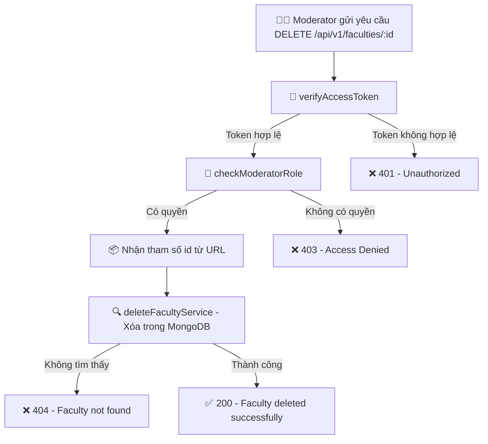

**Ghi chú bảo mật**

Chỉ Moderator hoặc Admin mới có quyền xóa khoa.

Xác thực JWT qua HTTP-only cookie để ngăn đánh cắp token.

Dữ liệu trả về là thông tin của khoa vừa xóa, không tiết lộ dữ liệu nhạy cảm khác.

Hệ thống sử dụng findByIdAndDelete của Mongoose để đảm bảo xóa atomic và an toàn.

### API Lấy Danh Sách Bác Sĩ Theo Khoa – GET /api/v1/doctors/faculty/:facultyId (Hiện tại chưa dùng đến)
**Mô tả tổng quan**

API này cho phép lấy danh sách tất cả bác sĩ (doctors) thuộc một khoa (faculty) cụ thể.

Thông tin trả về bao gồm dữ liệu tài khoản (Account) và hồ sơ bác sĩ (DoctorProfile), giúp hiển thị chi tiết trên dashboard hoặc trong profile của khoa.

**Phương thức & Đường dẫn**

GET `/api/v1/doctors/faculty/:facultyId`

**Yêu cầu xác thực**

Hiện tại endpoint này chưa bắt buộc token, có thể mở cho public hoặc thêm middleware verifyAccessToken/checkModeratorRole nếu muốn giới hạn quyền.

**Tham số đường dẫn (Path Params)**
| Trường      | Kiểu dữ liệu | Bắt buộc | Mô tả                                    |
| ----------- | ------------ | -------- | ---------------------------------------- |
| `facultyId` | string       | ✅        | MongoDB ObjectId của khoa cần lấy bác sĩ |

**Phản hồi thành công**
| Trường            | Kiểu dữ liệu | Mô tả               |
| ----------------- | ------------ | ------------------- |
| `_id`             | string       | ID tài khoản bác sĩ |
| `fullname`        | string       | Họ tên bác sĩ       |
| `email`           | string       | Email của bác sĩ    |
| `phone`           | string       | Số điện thoại       |
| `role`            | string       | Vai trò (`doctor`)  |
| `datebirth`       | string       | Ngày sinh (ISO)     |
| `specialization`  | string       | Chuyên khoa         |
| `experienceYears` | number       | Số năm kinh nghiệm  |
| `description`     | string       | Mô tả hồ sơ bác sĩ  |
| `clinicAddress`   | string       | Địa chỉ phòng khám  |

**Ví dụ Request**
```
GET /api/v1/doctors/faculty/6712aef91b9c5f001234abcd
```

**Ví dụ Response**
```
[
  {
    "_id": "6712aef91b9c5f001234aaa1",
    "fullname": "Nguyễn Văn A",
    "email": "doctorA@example.com",
    "phone": "0912345678",
    "role": "doctor",
    "datebirth": "1980-05-15T00:00:00.000Z",
    "specialization": "Tim mạch",
    "experienceYears": 12,
    "description": "Chuyên điều trị các bệnh lý tim mạch",
    "clinicAddress": "Tầng 5, Bệnh viện Trung Ương"
  },
  {
    "_id": "6712aef91b9c5f001234aaa2",
    "fullname": "Trần Thị B",
    "email": "doctorB@example.com",
    "phone": "0987654321",
    "role": "doctor",
    "datebirth": "1985-08-20T00:00:00.000Z",
    "specialization": "Răng Hàm Mặt",
    "experienceYears": 10,
    "description": "Điều trị các bệnh về răng miệng",
    "clinicAddress": "Tầng 3, Bệnh viện Trung Ương"
  }
]
```

**Quy trình xử lý**

**1. Nhận tham số facultyId từ URL**

Kiểm tra định dạng MongoDB ObjectId hợp lệ.

Nếu không hợp lệ → trả về 400 Bad Request.

**2. Truy vấn dữ liệu trong MongoDB**

Tìm tất cả DoctorProfile có facultyId tương ứng.

Sử dụng .populate() để lấy thông tin tài khoản (fullname, email, phone, role, datebirth).

Lọc các hồ sơ không có account hợp lệ.

**3. Kết hợp dữ liệu**

Ghép thông tin account và profile thành 1 object doctor duy nhất.

**4. Trả kết quả**

Thành công → HTTP 200 OK kèm danh sách bác sĩ.

Lỗi → HTTP 500 Internal Server Error.

**Các mã lỗi có thể gặp**
| Mã lỗi  | Nguyên nhân                            |
| ------- | -------------------------------------- |
| **400** | `facultyId` không hợp lệ hoặc thiếu    |
| **500** | Lỗi hệ thống hoặc lỗi truy vấn MongoDB |

**Sơ đồ luồng xử lý**
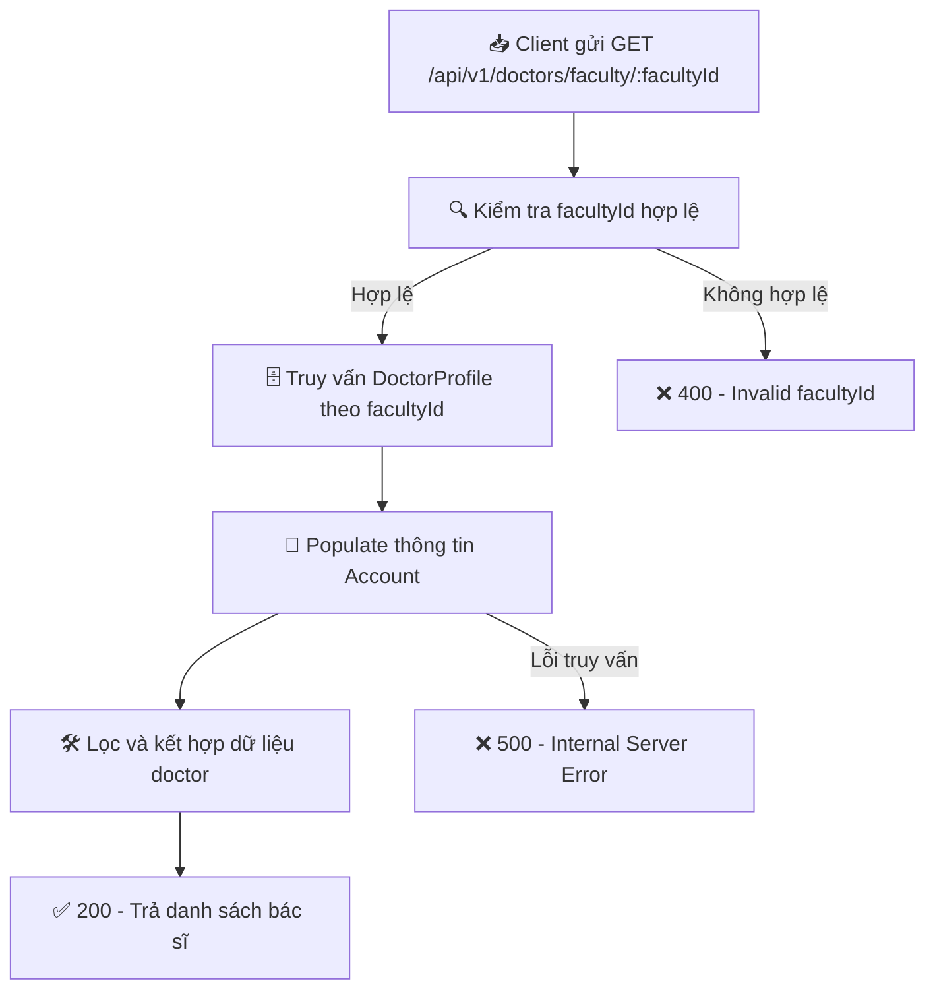

**Ghi chú bảo mật**

Endpoint có thể mở public hoặc thêm middleware bảo vệ nếu cần.

Trả về thông tin cơ bản của bác sĩ, không chứa dữ liệu nhạy cảm như mật khẩu.

Kiểm tra định dạng ObjectId để tránh lỗi hoặc truy vấn không mong muốn.

### API Tìm Kiếm Khoa – GET `/api/v1/faculties/search`
**Mô tả tổng quan**

API này cho phép Moderator hoặc người quản trị tìm kiếm các khoa (faculties) theo tên.
Hỗ trợ phân trang (pagination) để tải dữ liệu theo từng trang, thuận tiện cho giao diện dạng autocomplete hoặc lazy-loading search.

API được bảo vệ bởi 2 middleware:

- verifyAccessToken — Xác minh JWT token hợp lệ.

- checkModeratorRole — Chỉ cho phép Moderator trở lên truy cập.

**Phương thức & Đường dẫn**

`GET /api/v1/faculties/search?q=<tên_khoa>&page=1&limit=15`


**Yêu cầu xác thực**

| Middleware           | Chức năng                                        |
| -------------------- | ------------------------------------------------ |
| `verifyAccessToken`  | Kiểm tra JWT token trong cookie                  |
| `checkModeratorRole` | Đảm bảo tài khoản có vai trò `moderator` trở lên |


**Tham số truy vấn (Query Params)**

| Trường  | Kiểu dữ liệu | Bắt buộc | Mô tả                                      |
| ------- | ------------ | -------- | ------------------------------------------ |
| `q`     | string       | ✅        | Từ khóa tìm kiếm (phần tên khoa)           |
| `page`  | number       | ❌        | Trang hiện tại (mặc định = 1)              |
| `limit` | number       | ❌        | Số lượng bản ghi mỗi trang (mặc định = 15) |

**Phản hồi thành công**

| Trường                   | Kiểu dữ liệu | Mô tả                         |
| ------------------------ | ------------ | ----------------------------- |
| `message`                | string       | Thông báo tìm kiếm thành công |
| `faculties`              | array        | Danh sách khoa tìm được       |
| `faculties._id`          | string       | ID của khoa                   |
| `faculties.name`         | string       | Tên khoa                      |
| `pagination`             | object       | Thông tin phân trang chi tiết |
| `pagination.total`       | number       | Tổng số kết quả tìm được      |
| `pagination.totalPages`  | number       | Tổng số trang dữ liệu         |
| `pagination.currentPage` | number       | Trang hiện tại                |
| `pagination.limit`       | number       | Số bản ghi tối đa mỗi trang   |
| `pagination.hasNextPage` | boolean      | Có trang tiếp theo không      |
| `pagination.hasPrevPage` | boolean      | Có trang trước đó không       |

**Ví dụ Request**

```
GET /api/v1/faculties/search?q=Tim&page=2&limit=5
Cookie: accessToken=eyJhbGciOi...
```

**Ví dụ Response**
```
{
  "message": "Faculties searched successfully",
  "faculties": [
    { "_id": "67201abf7f...", "name": "Khoa Nội Tim Mạch" },
    { "_id": "67201abf7a...", "name": "Khoa Tim Mạch Can Thiệp" }
  ],
  "pagination": {
    "total": 12,
    "totalPages": 3,
    "currentPage": 2,
    "limit": 5,
    "hasNextPage": true,
    "hasPrevPage": true
  }
}
```

**Quy trình xử lý**

1. Xác thực & phân quyền

Middleware verifyAccessToken kiểm tra token hợp lệ.
→ Không hợp lệ → 401 Unauthorized.

Middleware checkModeratorRole đảm bảo quyền Moderator.
→ Không đủ quyền → 403 Access Denied.

2. Nhận tham số tìm kiếm và phân trang từ query

q — từ khóa tìm kiếm (bắt buộc).

page và limit — phân trang, mặc định page=1, limit=15.

Nếu q trống → trả về 400 Bad Request.

3. Xây dựng điều kiện tìm kiếm

Escape các ký tự đặc biệt trong q để tránh lỗi Regex.

Tạo Regex không phân biệt hoa thường: /q/i.

4. Truy vấn MongoDB với phân trang

.find({ name: regex }) → lấy dữ liệu.

.countDocuments() → đếm tổng kết quả.

.skip() & .limit() → phân trang.

5. Trả kết quả

Thành công → HTTP 200 OK kèm danh sách khoa và thông tin phân trang.

Lỗi → HTTP 500 Internal Server Error.

**Các mã lỗi có thể gặp**

| Mã lỗi  | Nguyên nhân                                      |
| ------- | ------------------------------------------------ |
| **400** | Tham số `q` trống hoặc không hợp lệ              |
| **401** | Token không hợp lệ hoặc hết hạn                  |
| **403** | Người dùng không có quyền (không phải Moderator) |
| **500** | Lỗi hệ thống hoặc lỗi truy xuất MongoDB          |


**Sơ đồ luồng xử lý**
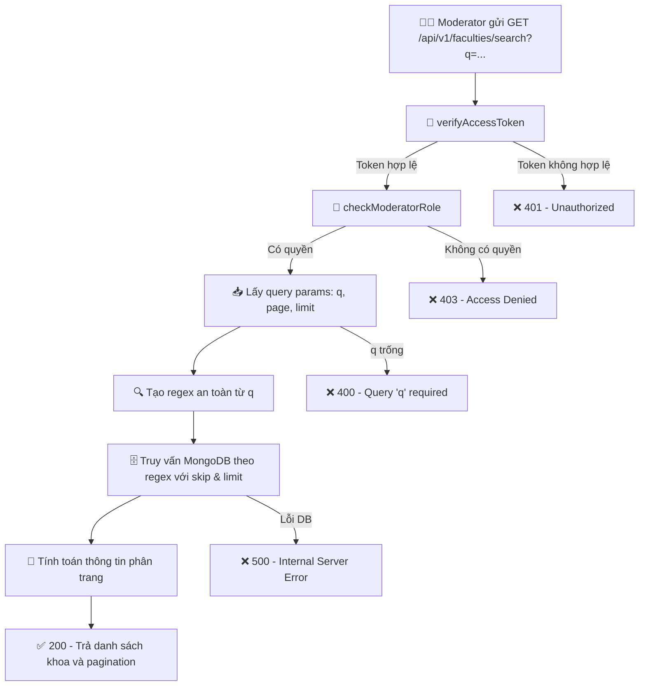

**Ghi chú bảo mật**

Chỉ Moderator trở lên được phép tìm kiếm.

Dữ liệu trả về chỉ gồm _id và name của khoa, không có thông tin nhạy cảm.

Regex được escape để tránh injection hoặc lỗi query.

Phân trang được tính toán chính xác dựa trên tổng số kết quả.

## APIs tương tác với hồ sơ bác sĩ
### API Tạo Hồ Sơ Bác Sĩ – `POST /api/v1/doctor-profiles`
**Mô tả tổng quan**

API này cho phép Moderator hoặc quản trị viên tạo mới một DoctorProfile cho tài khoản bác sĩ đã có sẵn.
Hồ sơ bao gồm chuyên khoa, kinh nghiệm, mô tả và địa chỉ phòng khám.
Endpoint này được dùng trong dashboard quản trị để quản lý hồ sơ bác sĩ trong hệ thống y tế.

API được bảo vệ bởi 2 middleware:

- verifyAccessToken — Xác minh JWT access token hợp lệ.

- checkModeratorRole — Đảm bảo chỉ Moderator trở lên mới có quyền tạo hồ sơ bác sĩ.

**Phương thức & Đường dẫn**
```
POST /api/v1/doctor-profiles
```

**Yêu cầu xác thực**
| Middleware           | Chức năng                                                  |
| -------------------- | ---------------------------------------------------------- |
| `verifyAccessToken`  | Kiểm tra JWT token trong cookie                            |
| `checkModeratorRole` | Chỉ cho phép tài khoản có vai trò `moderator` hoặc cao hơn |


**Tham số đầu vào**
| Trường            | Kiểu dữ liệu | Bắt buộc | Mô tả                         |
| ----------------- | ------------ | -------- | ----------------------------- |
| `accountId`       | string       | ✅        | ID tài khoản bác sĩ           |
| `facultyId`       | string       | ✅        | ID khoa mà bác sĩ thuộc       |
| `specialization`  | string       | ✅        | Chuyên môn của bác sĩ         |
| `experienceYears` | number       | ❌        | Số năm kinh nghiệm            |
| `description`     | string       | ❌        | Mô tả hoặc tiểu sử của bác sĩ |
| `clinicAddress`   | string       | ❌        | Địa chỉ phòng khám của bác sĩ |

**Phản hồi thành công**
| Trường    | Kiểu dữ liệu | Mô tả                                        |
| --------- | ------------ | -------------------------------------------- |
| `message` | string       | Thông báo tạo hồ sơ thành công               |
| `profile` | object       | Thông tin chi tiết của DoctorProfile vừa tạo |

**Ví dụ Request**
```
POST /api/v1/doctor-profiles
Cookie: accessToken=eyJhbGciOi...

{
  "accountId": "671a4b9ef1abc12345678901",
  "facultyId": "67201abf7fabc12345678902",
  "specialization": "Tim mạch",
  "experienceYears": 8,
  "description": "Chuyên gia tim mạch can thiệp",
  "clinicAddress": "Tầng 5, Bệnh viện Trung Ương"
}
```

**Ví dụ Response**
```
{
  "message": "Doctor profile created successfully",
  "profile": {
    "_id": "673b5c1df1abc12345678903",
    "accountId": "671a4b9ef1abc12345678901",
    "facultyId": "67201abf7fabc12345678902",
    "specialization": "Tim mạch",
    "experienceYears": 8,
    "description": "Chuyên gia tim mạch can thiệp",
    "clinicAddress": "Tầng 5, Bệnh viện Trung Ương",
    "createdAt": "2025-11-02T10:00:00.000Z"
  }
}
```

**Quy trình xử lý**

**1. Xác thực & phân quyền**

verifyAccessToken kiểm tra token hợp lệ → nếu không → 401 Unauthorized.

checkModeratorRole xác định quyền Moderator → nếu không đủ → 403 Access Denied.

**2. Kiểm tra dữ liệu đầu vào**

Các trường accountId, facultyId và specialization là bắt buộc → nếu thiếu → 400 Missing required fields.

**3. Kiểm tra tính hợp lệ của tài khoản và khoa**

accountId phải tồn tại và có role = "doctor".

facultyId phải tồn tại trong cơ sở dữ liệu.

Nếu không → trả lỗi 400 tương ứng (Account not found, Faculty not found, hoặc This account is not a doctor).

**4. Kiểm tra trùng hồ sơ**

Nếu đã tồn tại hồ sơ cho accountId → trả lỗi 400 Doctor profile already exists for this account.

**5. Tạo hồ sơ bác sĩ mới**

Tạo DoctorProfile và lưu vào MongoDB.

Nếu lưu thành công → trả về thông tin hồ sơ.

Nếu lỗi hệ thống → trả về 500 Failed to create doctor profile.

**Các mã lỗi có thể gặp**
| Mã lỗi  | Nguyên nhân                                        |
| ------- | -------------------------------------------------- |
| **400** | Thiếu thông tin bắt buộc hoặc dữ liệu không hợp lệ |
| **401** | Token không hợp lệ hoặc hết hạn                    |
| **403** | Người dùng không có quyền (không phải Moderator)   |
| **500** | Lỗi hệ thống hoặc lỗi khi ghi dữ liệu vào MongoDB  |

**Sơ đồ luồng xử lý**
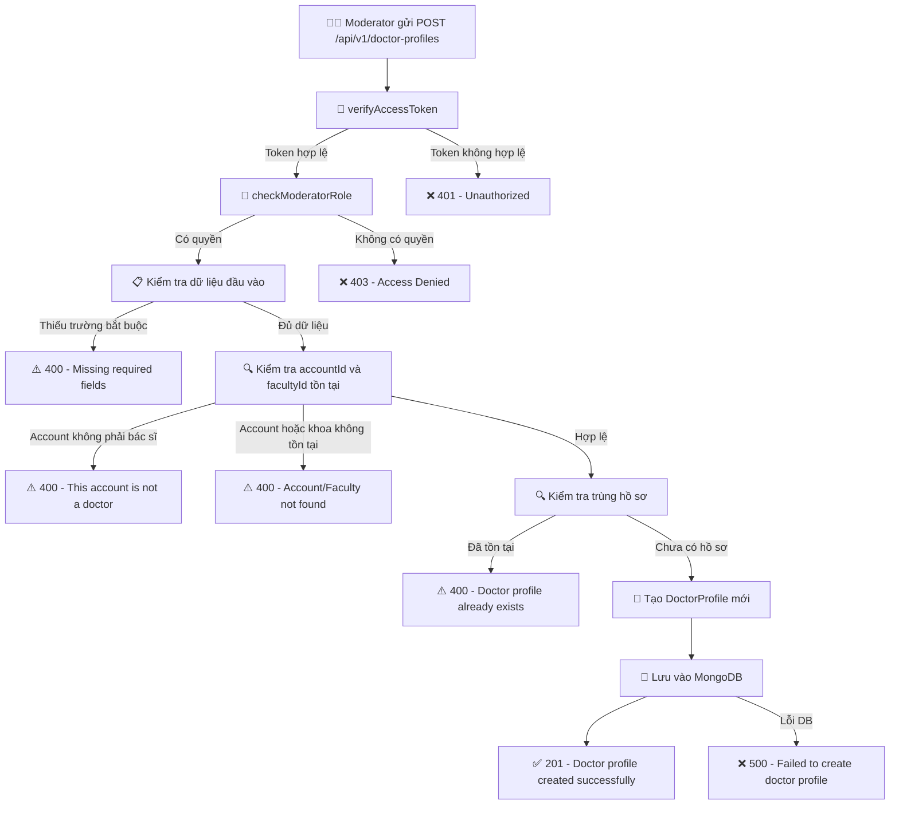

**Ghi chú bảo mật**

Chỉ Moderator trở lên mới có quyền tạo hồ sơ bác sĩ.

JWT token được xác thực qua HTTP-only cookie.

Dữ liệu nhạy cảm của bác sĩ (mật khẩu, thông tin cá nhân) không bị trả về API.

Tất cả dữ liệu đầu vào được kiểm tra và lưu trực tiếp vào MongoDB, đảm bảo tính toàn vẹn.

### API Lấy Hồ Sơ Bác Sĩ theo Account ID – GET `/api/v1/doctor-profiles/doctor/:accountId`

**Mô tả tổng quan**

API này cho phép Moderator hoặc quản trị viên lấy DoctorProfile của một bác sĩ dựa trên Account ID.
Thông tin trả về bao gồm dữ liệu hồ sơ, thông tin tài khoản và khoa mà bác sĩ thuộc về.

API được bảo vệ bởi middleware:

- verifyAccessToken — Xác minh JWT token hợp lệ.

**Phương thức & Đường dẫn**

```
GET /api/v1/doctor-profiles/doctor/:accountId
```

**Yêu cầu xác thực**

| Middleware          | Chức năng                       |
| ------------------- | ------------------------------- |
| `verifyAccessToken` | Kiểm tra JWT token trong cookie |

**Tham số đường dẫn (Route Params)**
| Trường      | Kiểu dữ liệu | Bắt buộc | Mô tả                                  |
| ----------- | ------------ | -------- | -------------------------------------- |
| `accountId` | string       | ✅        | ID của tài khoản bác sĩ muốn lấy hồ sơ |

**Phản hồi thành công**
| Trường                    | Kiểu dữ liệu | Mô tả                                                                |
| ------------------------- | ------------ | -------------------------------------------------------------------- |
| `message`                 | string       | Thông báo lấy hồ sơ thành công                                       |
| `profile`                 | object       | Hồ sơ bác sĩ bao gồm account và faculty                              |
| `profile.accountId`       | object       | Thông tin tài khoản bác sĩ (fullname, email, phone, datebirth, role) |
| `profile.facultyId`       | object       | Thông tin khoa bác sĩ thuộc (name, description, location)            |
| `profile.specialization`  | string       | Chuyên môn của bác sĩ                                                |
| `profile.experienceYears` | number       | Số năm kinh nghiệm                                                   |
| `profile.description`     | string       | Mô tả hoặc tiểu sử                                                   |
| `profile.clinicAddress`   | string       | Địa chỉ phòng khám                                                   |

**Ví dụ Request**
```
GET /api/v1/doctor-profiles/doctor/671a4b9ef1abc12345678901
Cookie: accessToken=eyJhbGciOi...
```

**Ví dụ Response**
```
{
  "message": "Doctor profile fetched successfully",
  "profile": {
    "_id": "673b5c1df1abc12345678903",
    "accountId": {
      "_id": "671a4b9ef1abc12345678901",
      "fullname": "Nguyễn Văn A",
      "email": "doctorA@example.com",
      "phone": "0912345678",
      "datebirth": "1980-05-12",
      "role": "doctor"
    },
    "facultyId": {
      "_id": "67201abf7fabc12345678902",
      "name": "Tim mạch",
      "description": "Khoa chuyên về điều trị tim mạch",
      "location": "Tầng 5, Bệnh viện Trung Ương"
    },
    "specialization": "Tim mạch can thiệp",
    "experienceYears": 8,
    "description": "Chuyên gia tim mạch can thiệp",
    "clinicAddress": "Tầng 5, Bệnh viện Trung Ương",
    "createdAt": "2025-11-02T10:00:00.000Z"
  }
}
```

**Quy trình xử lý**
**1. Xác thực**

Middleware verifyAccessToken kiểm tra token hợp lệ → nếu không hợp lệ → 401 Unauthorized.

**2. Kiểm tra tham số đường dẫn**

accountId là bắt buộc → nếu thiếu → 400 Account ID is required.

**3. Truy vấn cơ sở dữ liệu**

Tìm DoctorProfile theo accountId.

Populate thông tin accountId và facultyId từ các collection liên quan.

Nếu không tìm thấy → 404 Doctor profile not found for this account ID.

**4. Trả kết quả cho client**

Thành công → HTTP 200 OK kèm hồ sơ bác sĩ.

Lỗi hệ thống → HTTP 500 Internal Server Error.

**Các mã lỗi có thể gặp**
| Mã lỗi  | Nguyên nhân                                    |
| ------- | ---------------------------------------------- |
| **400** | Thiếu `accountId`                              |
| **401** | Token không hợp lệ hoặc hết hạn                |
| **404** | Hồ sơ bác sĩ không tồn tại cho `accountId` này |
| **500** | Lỗi hệ thống hoặc lỗi khi truy xuất MongoDB    |

**Sơ đồ luồng xử lý**
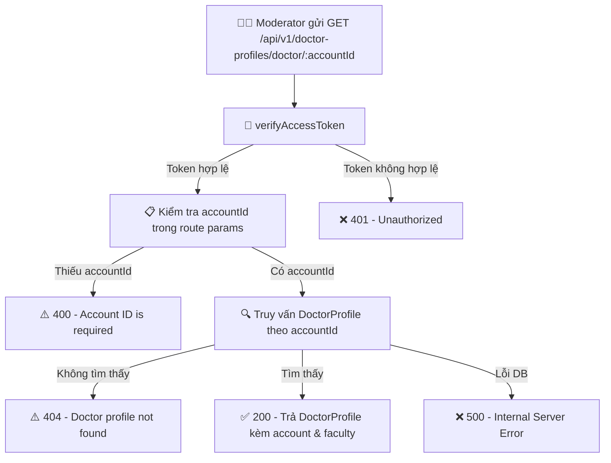

**Ghi chú bảo mật**

Endpoint yêu cầu token hợp lệ, chỉ người đã đăng nhập mới được truy cập.

Thông tin nhạy cảm của bác sĩ (mật khẩu, thông tin bảo mật) không được trả về.

Dữ liệu trả về được populate đầy đủ thông tin tài khoản và khoa để tiện hiển thị dashboard.

### API Lấy Danh Sách Hồ Sơ Bác Sĩ – GET `/api/v1/doctor-profiles/doctor`
**Mô tả tổng quan**

API này cho phép Moderator hoặc quản trị viên lấy danh sách tất cả DoctorProfiles trong hệ thống, hỗ trợ phân trang (pagination).
Thông tin trả về bao gồm hồ sơ bác sĩ, thông tin tài khoản liên kết, và tên khoa bác sĩ thuộc về.

API được bảo vệ bởi 2 middleware:

- verifyAccessToken — Xác minh JWT token hợp lệ.

- checkModeratorRole — Chỉ Moderator trở lên mới có quyền truy cập.

**Phương thức & Đường dẫn**
```
GET /api/v1/doctor-profiles/doctor?page=1&limit=10
```

**Yêu cầu xác thực**
| Middleware           | Chức năng                                     |
| -------------------- | --------------------------------------------- |
| `verifyAccessToken`  | Kiểm tra JWT token trong cookie               |
| `checkModeratorRole` | Chỉ cho phép tài khoản có vai trò `moderator` |

**Tham số truy vấn (Query Params)**
| Trường  | Kiểu dữ liệu | Bắt buộc | Mô tả                                    |
| ------- | ------------ | -------- | ---------------------------------------- |
| `page`  | number       | ❌        | Trang hiện tại (mặc định = 1)            |
| `limit` | number       | ❌        | Số lượng hồ sơ mỗi trang (mặc định = 10) |

**Phản hồi thành công**
| Trường                     | Kiểu dữ liệu | Mô tả                                                     |
| -------------------------- | ------------ | --------------------------------------------------------- |
| `message`                  | string       | Thông báo lấy danh sách thành công                        |
| `profiles`                 | array        | Mảng các hồ sơ bác sĩ trên trang hiện tại                 |
| `profiles.accountId`       | object       | Thông tin tài khoản bác sĩ (fullname, email, phone, role) |
| `profiles.facultyId`       | object       | Thông tin khoa bác sĩ thuộc (name)                        |
| `profiles.specialization`  | string       | Chuyên môn của bác sĩ                                     |
| `profiles.experienceYears` | number       | Số năm kinh nghiệm                                        |
| `profiles.description`     | string       | Tiểu sử hoặc mô tả của bác sĩ                             |
| `profiles.clinicAddress`   | string       | Địa chỉ phòng khám                                        |
| `pagination`               | object       | Thông tin phân trang                                      |
| `pagination.total`         | number       | Tổng số hồ sơ trong hệ thống                              |
| `pagination.totalPages`    | number       | Tổng số trang dữ liệu                                     |
| `pagination.currentPage`   | number       | Trang hiện tại                                            |
| `pagination.limit`         | number       | Số bản ghi tối đa mỗi trang                               |
| `pagination.hasNextPage`   | boolean      | Có trang tiếp theo không                                  |
| `pagination.hasPrevPage`   | boolean      | Có trang trước đó không                                   |

**Ví dụ Request**
```
GET /api/v1/doctor-profiles/doctor?page=2&limit=5
Cookie: accessToken=eyJhbGciOi...
```

**Ví dụ Response**
```
{
  "message": "Doctor profiles fetched successfully",
  "profiles": [
    {
      "_id": "673b5c1df1abc12345678903",
      "accountId": {
        "_id": "671a4b9ef1abc12345678901",
        "fullname": "Nguyễn Văn A",
        "email": "doctorA@example.com",
        "phone": "0912345678",
        "role": "doctor"
      },
      "facultyId": {
        "_id": "67201abf7fabc12345678902",
        "name": "Tim mạch"
      },
      "specialization": "Tim mạch can thiệp",
      "experienceYears": 8,
      "description": "Chuyên gia tim mạch can thiệp",
      "clinicAddress": "Tầng 5, Bệnh viện Trung Ương"
    }
  ],
  "pagination": {
    "total": 23,
    "totalPages": 5,
    "currentPage": 2,
    "limit": 5,
    "hasNextPage": true,
    "hasPrevPage": true
  }
}
```

**Quy trình xử lý**

**1. Xác thực & phân quyền
**
Middleware verifyAccessToken kiểm tra token hợp lệ → 401 Unauthorized nếu không hợp lệ.

Middleware checkModeratorRole xác thực quyền → 403 Access Denied nếu không phải Moderator.

**2. Lấy tham số phân trang**

page và limit từ query params, nếu không có → dùng mặc định page = 1, limit = 10.

**3. Truy vấn cơ sở dữ liệu**

Tìm tất cả DoctorProfiles với .skip(skip) và .limit(limit).

Populate thông tin accountId và facultyId.

Đếm tổng số hồ sơ bằng countDocuments().

**4. Tính toán phân trang**

Tính totalPages, hasNextPage, hasPrevPage.

**5. Trả kết quả**

Thành công → 200 OK kèm danh sách hồ sơ và thông tin phân trang.

Lỗi hệ thống → 500 Internal Server Error.

**Các mã lỗi có thể gặp**
| Mã lỗi  | Nguyên nhân                                      |
| ------- | ------------------------------------------------ |
| **401** | Token không hợp lệ hoặc hết hạn                  |
| **403** | Người dùng không có quyền (không phải Moderator) |
| **500** | Lỗi hệ thống hoặc lỗi khi truy xuất MongoDB      |

**Sơ đồ luồng xử lý**
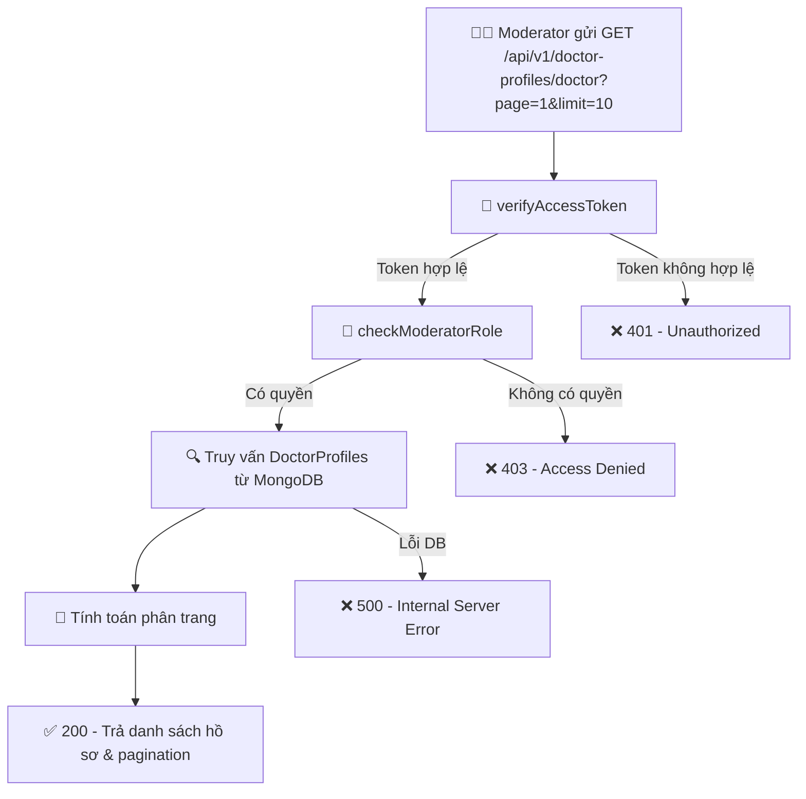

**Ghi chú bảo mật**

Chỉ Moderator có quyền truy cập.

Token được xác thực qua HTTP-only cookie.

Thông tin nhạy cảm (mật khẩu, bảo mật) không được trả về.

Pagination giúp tối ưu hiệu năng khi có nhiều hồ sơ bác sĩ.

### API Tìm Kiếm Bác Sĩ – GET `/api/v1/doctor-profiles/doctors/search`
**Mô tả tổng quan**

API này cho phép Moderator hoặc quản trị viên tìm kiếm các bác sĩ trong hệ thống dựa trên fullname hoặc email, hỗ trợ phân trang (pagination) để hiển thị kết quả từng phần.
Endpoint này rất hữu ích khi muốn gợi ý bác sĩ trong dropdown hoặc lọc danh sách bác sĩ theo từ khóa.

API được bảo vệ bởi 2 middleware:

- verifyAccessToken — Xác minh JWT token hợp lệ.

- checkModeratorRole — Chỉ Moderator trở lên mới có quyền truy cập.

**Phương thức & Đường dẫn**
```
GET /api/v1/doctor-profiles/doctors/search?q=Nguyen&page=1&limit=20
```

**Yêu cầu xác thực**
| Middleware           | Chức năng                                     |
| -------------------- | --------------------------------------------- |
| `verifyAccessToken`  | Kiểm tra JWT token trong cookie               |
| `checkModeratorRole` | Chỉ cho phép tài khoản có vai trò `moderator` |

**Tham số truy vấn (Query Params)**
| Trường  | Kiểu dữ liệu | Bắt buộc | Mô tả                                     |
| ------- | ------------ | -------- | ----------------------------------------- |
| `q`     | string       | ✅        | Từ khóa tìm kiếm (fullname hoặc email)    |
| `page`  | number       | ❌        | Trang hiện tại (mặc định = 1)             |
| `limit` | number       | ❌        | Số lượng bác sĩ mỗi trang (mặc định = 20) |

**Phản hồi thành công**
| Trường                   | Kiểu dữ liệu | Mô tả                         |
| ------------------------ | ------------ | ----------------------------- |
| `message`                | string       | Thông báo tìm kiếm thành công |
| `doctors`                | array        | Mảng các bác sĩ tìm được      |
| `doctors._id`            | string       | ID tài khoản bác sĩ           |
| `doctors.fullname`       | string       | Họ và tên bác sĩ              |
| `doctors.email`          | string       | Email của bác sĩ              |
| `pagination`             | object       | Thông tin phân trang          |
| `pagination.total`       | number       | Tổng số kết quả tìm kiếm      |
| `pagination.totalPages`  | number       | Tổng số trang dữ liệu         |
| `pagination.currentPage` | number       | Trang hiện tại                |
| `pagination.limit`       | number       | Số bản ghi tối đa mỗi trang   |
| `pagination.hasNextPage` | boolean      | Có trang tiếp theo không      |
| `pagination.hasPrevPage` | boolean      | Có trang trước đó không       |

**Ví dụ Request**
```
GET /api/v1/doctor-profiles/doctors/search?q=Nguyen&page=2&limit=10
Cookie: accessToken=eyJhbGciOi...
```

**Ví dụ Response**
```
{
  "message": "Doctors searched successfully",
  "doctors": [
    {
      "_id": "671a4b9ef1abc12345678901",
      "fullname": "Nguyễn Văn A",
      "email": "doctorA@example.com"
    },
    {
      "_id": "671a4b9ef1abc12345678902",
      "fullname": "Nguyễn Thị B",
      "email": "doctorB@example.com"
    }
  ],
  "pagination": {
    "total": 45,
    "totalPages": 5,
    "currentPage": 2,
    "limit": 10,
    "hasNextPage": true,
    "hasPrevPage": true
  }
}
```

**Quy trình xử lý**

**1. Xác thực & phân quyền**

Middleware verifyAccessToken kiểm tra token hợp lệ → 401 Unauthorized nếu không hợp lệ.

Middleware checkModeratorRole xác thực quyền → 403 Access Denied nếu không phải Moderator.

**2. Lấy tham số tìm kiếm và phân trang**

q, page và limit từ query params.

Nếu không có → mặc định page = 1, limit = 20.

**3. Truy vấn cơ sở dữ liệu**

Tìm các tài khoản với role = doctor và fullname hoặc email khớp regex tìm kiếm.

Sử dụng $or để kiểm tra fullname hoặc email.

Sắp xếp theo fullname, áp dụng .skip() và .limit() cho pagination.

Đếm tổng số kết quả bằng countDocuments().

**4. Tính toán phân trang**

Tính totalPages, hasNextPage, hasPrevPage.

**5. Trả kết quả**

Thành công → 200 OK kèm danh sách bác sĩ và thông tin phân trang.

Lỗi hệ thống → 500 Internal Server Error.

**Các mã lỗi có thể gặp**
| Mã lỗi  | Nguyên nhân                                      |
| ------- | ------------------------------------------------ |
| **400** | Thiếu từ khóa tìm kiếm (`q`)                     |
| **401** | Token không hợp lệ hoặc hết hạn                  |
| **403** | Người dùng không có quyền (không phải Moderator) |
| **500** | Lỗi hệ thống hoặc lỗi khi truy xuất MongoDB      |

**Sơ đồ luồng xử lý**
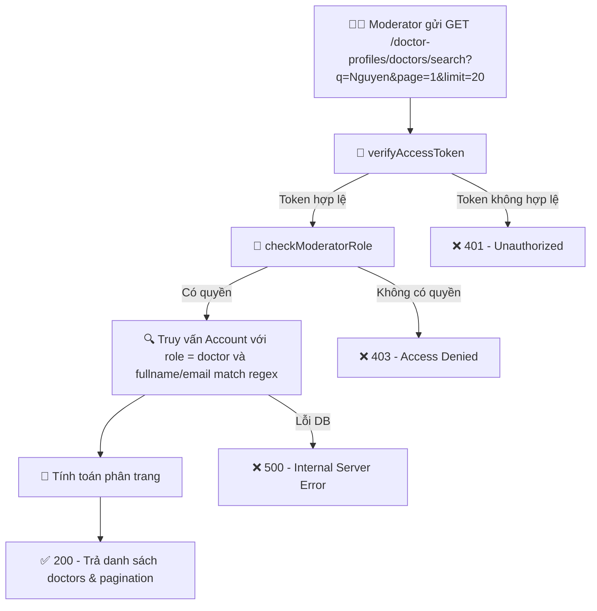

**Ghi chú bảo mật**

Chỉ Moderator có quyền truy cập.

Token được xác thực qua HTTP-only cookie.

Thông tin nhạy cảm (mật khẩu, dữ liệu nhạy cảm) không được trả về.

Pagination giúp tối ưu hiệu năng khi số lượng bác sĩ lớn.

### API Cập Nhật Thông Tin Bác Sĩ – PUT `/api/v1/doctor-profiles/doctor/:accountId`

**Mô tả tổng quan**

API này cho phép Moderator cập nhật thông tin DoctorProfile dựa trên Account ID.
Các trường có thể cập nhật bao gồm: facultyId, specialization, experienceYears, description, clinicAddress.
Endpoint này dùng trong dashboard quản trị hoặc quản lý hồ sơ bác sĩ.

API được bảo vệ bởi 2 middleware:

- verifyAccessToken — Xác minh JWT access token hợp lệ.

- checkModeratorRole — Chỉ Moderator mới có quyền cập nhật.

**Phương thức & Đường dẫn**
```
PUT /api/v1/doctor-profiles/doctor/:accountId
```

**Yêu cầu xác thực**
| Middleware           | Chức năng                                     |
| -------------------- | --------------------------------------------- |
| `verifyAccessToken`  | Kiểm tra JWT token trong cookie               |
| `checkModeratorRole` | Chỉ cho phép tài khoản có vai trò `moderator` |

**Tham số đầu vào**
| Trường            | Kiểu dữ liệu | Bắt buộc | Mô tả                                |
| ----------------- | ------------ | -------- | ------------------------------------ |
| `accountId`       | string       | ✅        | ID của tài khoản bác sĩ cần cập nhật |
| `facultyId`       | string       | ❌        | ID khoa mới (nếu muốn thay đổi)      |
| `specialization`  | string       | ❌        | Chuyên môn của bác sĩ                |
| `experienceYears` | number       | ❌        | Số năm kinh nghiệm (>=0)             |
| `description`     | string       | ❌        | Mô tả/tiểu sử bác sĩ                 |
| `clinicAddress`   | string       | ❌        | Địa chỉ phòng khám của bác sĩ        |

Lưu ý: Không thể thay đổi accountId hoặc _id của profile.

**Phản hồi thành công**
| Trường              | Kiểu dữ liệu | Mô tả                                              |
| ------------------- | ------------ | -------------------------------------------------- |
| `message`           | string       | Thông báo cập nhật thành công                      |
| `profile`           | object       | Thông tin bác sĩ sau khi cập nhật                  |
| `profile.accountId` | object       | Thông tin tài khoản (fullname, email, phone, role) |
| `profile.facultyId` | object       | Thông tin khoa (name)                              |

**Ví dụ Request**
```
PUT /api/v1/doctor-profiles/doctor/671a4b9ef1abc12345678901
Cookie: accessToken=eyJhbGciOi...

{
  "facultyId": "671a4b9ef1abc12345678910",
  "specialization": "Tim Mạch",
  "experienceYears": 5,
  "description": "Chuyên điều trị các bệnh lý tim mạch.",
  "clinicAddress": "Tầng 5, Bệnh viện Trung Ương"
}
```

**Ví dụ Response**
```
{
  "message": "Doctor profile updated successfully",
  "profile": {
    "_id": "671a4b9ef1abc12345678901",
    "accountId": {
      "_id": "671a4b9ef1abc12345678901",
      "fullname": "Nguyễn Văn A",
      "email": "doctorA@example.com",
      "phone": "0123456789",
      "role": "doctor"
    },
    "facultyId": {
      "_id": "671a4b9ef1abc12345678910",
      "name": "Tim Mạch"
    },
    "specialization": "Tim Mạch",
    "experienceYears": 5,
    "description": "Chuyên điều trị các bệnh lý tim mạch.",
    "clinicAddress": "Tầng 5, Bệnh viện Trung Ương"
  }
}
```

**Quy trình xử lý**

**1. Xác thực & phân quyền**

verifyAccessToken → 401 Unauthorized nếu token không hợp lệ.

checkModeratorRole → 403 Access Denied nếu không phải Moderator.

**2. Kiểm tra dữ liệu đầu vào**

accountId phải có.

Không có dữ liệu cập nhật → trả về 400 No update data provided.

**3. Tìm profile**

Tìm DoctorProfile theo accountId.

Không tìm thấy → trả về 404 Doctor profile not found.

**4. Kiểm tra & cập nhật các trường**

facultyId mới → xác thực tồn tại trong MongoDB.

specialization, experienceYears, description, clinicAddress → cập nhật trực tiếp.

experienceYears phải >=0, không hợp lệ → mặc định = 0.

**5. Lưu & trả kết quả**

Lưu profile mới.

Populate accountId và facultyId trước khi trả về.

Thành công → 200 OK với profile mới.

**Các mã lỗi có thể gặp**
| Mã lỗi  | Nguyên nhân                                      |
| ------- | ------------------------------------------------ |
| **400** | Thiếu `accountId` hoặc không có dữ liệu cập nhật |
| **401** | Token không hợp lệ hoặc hết hạn                  |
| **403** | Người dùng không có quyền (không phải Moderator) |
| **404** | Không tìm thấy profile cho `accountId`           |
| **500** | Lỗi hệ thống hoặc lỗi lưu dữ liệu vào MongoDB    |

**Sơ đồ luồng xử lý**
```mermaid
flowchart TD
    A[🧑‍💼 Moderator gửi PUT /doctor/:accountId] --> B[🔐 verifyAccessToken]
    B -->|Token hợp lệ| C[🧩 checkModeratorRole]
    B -->|Token không hợp lệ| X1[❌ 401 - Unauthorized]
    C -->|Có quyền| D[📋 Kiểm tra dữ liệu đầu vào]
    C -->|Không có quyền| X2[❌ 403 - Access Denied]
    D -->|Thiếu accountId hoặc updateData| X3[⚠️ 400 - Bad Request]
    D -->|Đủ dữ liệu| E[🔍 Tìm DoctorProfile theo accountId]
    E -->|Không tìm thấy| X4[❌ 404 - Not Found]
    E -->|Tìm thấy| F[🧱 Cập nhật các trường hợp lệ]
    F --> G[💾 Lưu profile vào MongoDB]
    G --> H[✅ 200 - Trả profile đã cập nhật]
    F -->|Lỗi DB| X5[❌ 500 - Internal Server Error]
```

**Ghi chú bảo mật**

Chỉ Moderator có quyền truy cập.

Token được xác thực qua HTTP-only cookie.

Không cho phép thay đổi accountId hoặc _id của profile.

Các dữ liệu quan trọng được validate trước khi lưu vào MongoDB.

### API Xóa Hồ Sơ Bác Sĩ – DELETE `/api/v1/doctor-profiles/doctor/:accountId`

**Mô tả tổng quan**

API này cho phép Moderator xóa hồ sơ của một bác sĩ dựa trên Account ID.
Thao tác này chỉ xóa DoctorProfile (thông tin chuyên môn của bác sĩ), không xóa tài khoản Account gốc.

Chức năng thường được dùng khi quản trị viên cần loại bỏ hồ sơ bác sĩ khỏi hệ thống.

**Phương thức & Đường dẫn**
```
DELETE /api/v1/doctor-profiles/doctor/:accountId
```

**Yêu cầu xác thực**
| Middleware           | Chức năng                                          |
| -------------------- | -------------------------------------------------- |
| `verifyAccessToken`  | Xác minh JWT access token từ cookie                |
| `checkModeratorRole` | Đảm bảo chỉ người có quyền Moderator được phép xóa |

**Tham số đầu vào**
| Trường      | Kiểu dữ liệu | Bắt buộc | Mô tả                                 |
| ----------- | ------------ | -------- | ------------------------------------- |
| `accountId` | string       | ✅        | ID của tài khoản bác sĩ cần xóa hồ sơ |

Lưu ý: API này chỉ xóa hồ sơ trong DoctorProfile, không ảnh hưởng đến tài khoản Account.

**Phản hồi thành công**
| Trường    | Kiểu dữ liệu | Mô tả                              |
| --------- | ------------ | ---------------------------------- |
| `message` | string       | Thông báo xác nhận hồ sơ đã bị xóa |

**Ví dụ Request**
```
DELETE /api/v1/doctor-profiles/doctor/671a4b9ef1abc12345678901
Cookie: accessToken=eyJhbGciOi...
```

**Ví dụ Response**
```
{
  "message": "Doctor profile deleted successfully"
}
```

**Quy trình xử lý**

**1. Xác thực & phân quyền**

verifyAccessToken → Kiểm tra token trong cookie (HTTP-only).

checkModeratorRole → Chỉ Moderator mới được quyền thực thi.

**2. Kiểm tra dữ liệu đầu vào**

Nếu không có accountId → 400 Account ID is required.

**3. Thực thi xóa hồ sơ**

Tìm hồ sơ bác sĩ theo accountId bằng findOneAndDelete.

Nếu không tìm thấy → 404 Doctor profile not found for this account ID.

Nếu tìm thấy → Xóa hồ sơ và trả về thông báo thành công.

**4. Trả phản hồi**

Thành công → 200 OK với thông báo "Doctor profile deleted successfully".

Có thể tùy chọn dùng 204 No Content nếu không cần trả dữ liệu.

**Các mã lỗi có thể gặp**
| Mã lỗi  | Nguyên nhân                                         |
| ------- | --------------------------------------------------- |
| **400** | Thiếu `accountId` trong URL                         |
| **401** | Token không hợp lệ hoặc đã hết hạn                  |
| **403** | Người dùng không có quyền (không phải Moderator)    |
| **404** | Không tìm thấy hồ sơ bác sĩ tương ứng với accountId |
| **500** | Lỗi hệ thống hoặc truy vấn MongoDB thất bại         |

**Sơ đồ luồng xử lý**
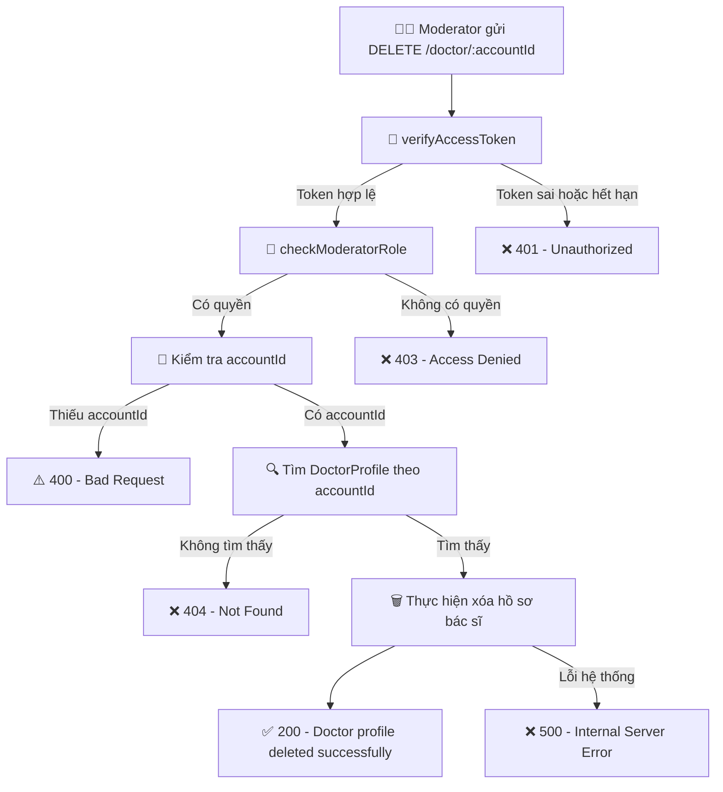

**Ghi chú bảo mật**

Token được xác thực qua cookie HTTP-only để chống XSS.

Chỉ Moderator có quyền gọi endpoint này.

Nếu muốn xóa luôn cả tài khoản bác sĩ, cần dùng endpoint khác (DELETE /api/v1/accounts/:id).

API này chỉ đảm nhiệm xóa hồ sơ nghề nghiệp (DoctorProfile) mà không ảnh hưởng đến thông tin đăng nhập.

## APIs tương tác dữ liệu lịch khám bệnh

### API Tạo Lịch Khám – POST `/api/v1/schedules`
**Mô tả tổng quan**

API này cho phép bệnh nhân tự đăng ký một lịch hẹn khám bệnh trong hệ thống.

Thông tin bao gồm ngày hẹn, mô tả bệnh lý, và ID của bệnh nhân.

Bác sĩ và khoa sẽ được gán sau bởi quản trị viên (Admin), do đó ban đầu hai trường này để null.

**Phương thức & Đường dẫn**
```
POST /api/v1/schedules
```

**Yêu cầu xác thực**
| Middleware          | Chức năng                                            |
| ------------------- | ---------------------------------------------------- |
| `verifyAccessToken` | Xác minh JWT token để đảm bảo bệnh nhân đã đăng nhập |

**Tham số đầu vào (Request Body)**
| Trường               | Kiểu dữ liệu | Bắt buộc | Mô tả                                                                   |
| -------------------- | ------------ | -------- | ----------------------------------------------------------------------- |
| `patientId`          | string       | ✅        | ID của bệnh nhân (MongoDB ObjectId)                                     |
| `appointmentDate`    | string (ISO) | ✅        | Ngày giờ hẹn khám (định dạng ISO 8601, ví dụ: `"2025-11-02T09:00:00Z"`) |
| `illnessDescription` | string       | ✅        | Mô tả tình trạng bệnh hoặc lý do khám                                   |

**Phản hồi thành công**
| Trường    | Kiểu dữ liệu | Mô tả                                     |
| --------- | ------------ | ----------------------------------------- |
| `message` | string       | Thông báo xác nhận đã tạo lịch thành công |

**Ví dụ Request**
```
POST /api/v1/schedules
Cookie: accessToken=eyJhbGciOi...
Content-Type: application/json

{
  "patientId": "670f2a8c1b9c5f0012345678",
  "appointmentDate": "2025-11-02T09:00:00Z",
  "illnessDescription": "Đau đầu kéo dài 3 ngày"
}
```

**Ví dụ Response**
```
{
  "message": "Schedule created successfully"
}
```

**Quy trình xử lý**

**1. Xác thực người dùng**

Middleware verifyAccessToken kiểm tra token từ cookie.

Chỉ người dùng hợp lệ (bệnh nhân) mới được phép gửi yêu cầu.

**2. Kiểm tra dữ liệu đầu vào**

Thiếu patientId, appointmentDate, hoặc illnessDescription → trả 400 Missing required fields.

Kiểm tra patientId hợp lệ (định dạng ObjectId).

Kiểm tra appointmentDate có hợp lệ và đúng định dạng thời gian.

**3. Kiểm tra trùng lịch**

Hệ thống kiểm tra xem bệnh nhân có lịch hẹn trùng thời gian không.
Nếu có → trả lỗi 400 You already have a schedule at this date/time.

**4. Tạo mới lịch hẹn**

Nếu hợp lệ → tạo bản ghi Schedule với trạng thái mặc định pending.

Gán:

doctorId: null

facultyId: null

status: "pending"

**5. Trả phản hồi**

Thành công → 201 Created với thông báo "Schedule created successfully".

Lỗi trong quá trình lưu DB → 500 Internal server error.

**Các mã lỗi có thể gặp**
| Mã lỗi  | Nguyên nhân                                                   |
| ------- | ------------------------------------------------------------- |
| **400** | Thiếu dữ liệu bắt buộc hoặc lịch bị trùng                     |
| **401** | Token không hợp lệ hoặc đã hết hạn                            |
| **500** | Lỗi hệ thống, ví dụ khi truy cập hoặc lưu dữ liệu vào MongoDB |

**Sơ đồ luồng xử lý**
```mermaid
flowchart TD
    A[🧑‍⚕️ Bệnh nhân gửi POST /schedules] --> B[🔐 verifyAccessToken]
    B -->|Token hợp lệ| C[📋 Kiểm tra dữ liệu đầu vào]
    B -->|Token sai hoặc hết hạn| X1[❌ 401 - Unauthorized]
    C -->|Thiếu dữ liệu| X2[⚠️ 400 - Missing required fields]
    C -->|Đủ dữ liệu| D[🔎 Kiểm tra trùng lịch hẹn]
    D -->|Trùng lịch| X3[⚠️ 400 - Schedule already exists]
    D -->|Không trùng| E[🗓️ Tạo lịch hẹn mới (status=pending)]
    E -->|Lưu thành công| F[✅ 201 - Schedule created successfully]
    E -->|Lỗi DB| X4[❌ 500 - Internal Server Error]
```

***Ghi chú kỹ thuật***

CSDL sử dụng: MongoDB (Model Schedule).

Các trường mặc định khi tạo:
```
{
  doctorId: null,
  facultyId: null,
  status: "pending"
}
```

Xác thực: Token được lấy từ cookie HTTP-only, bảo mật chống XSS.

Vai trò: Chỉ bệnh nhân (hoặc người dùng đăng nhập hợp lệ) mới được phép đặt lịch.

### API Phân Công Bác Sĩ Cho Lịch Khám – PUT `/api/v1/schedules/:scheduleId/assign`
**Mô tả tổng quan**

API này cho phép Admin thực hiện phân công bác sĩ và khoa cho một lịch khám mà bệnh nhân đã đăng ký.

Chỉ các lịch có trạng thái "pending" mới có thể được gán. Sau khi gán, trạng thái sẽ chuyển sang "assigned".

Chức năng này thường được dùng trong quy trình quản trị để sắp xếp bác sĩ phù hợp cho từng bệnh nhân.

**Phương thức & Đường dẫn**
```
PUT /api/v1/schedules/:scheduleId/assign
```

**Yêu cầu xác thực**
| Middleware          | Chức năng                              |
| ------------------- | -------------------------------------- |
| `verifyAccessToken` | Xác minh JWT token trong cookie        |
| `checkAdminRole`    | Chỉ cho phép Admin thực hiện phân công |

**Tham số đầu vào**
| Trường       | Kiểu dữ liệu | Bắt buộc | Mô tả                          |
| ------------ | ------------ | -------- | ------------------------------ |
| `scheduleId` | string       | ✅        | ID của lịch khám cần phân công |

**Request Body**
| Trường       | Kiểu dữ liệu | Bắt buộc | Mô tả                                              |
| ------------ | ------------ | -------- | -------------------------------------------------- |
| `doctorId`   | string       | ✅        | ID của bác sĩ được chỉ định (MongoDB ObjectId)     |
| `facultyId`  | string       | ✅        | ID của khoa/phòng ban tương ứng (MongoDB ObjectId) |
| `adminNotes` | string       | ❌        | Ghi chú nội bộ của Admin (nếu có)                  |

**Phản hồi thành công**
| Trường    | Kiểu dữ liệu | Mô tả                                   |
| --------- | ------------ | --------------------------------------- |
| `message` | string       | Thông báo xác nhận phân công thành công |

**Ví dụ Request**
```
PUT /api/v1/schedules/6710d9ad1c23b10012876543/assign
Cookie: accessToken=eyJhbGciOi...
Content-Type: application/json

{
  "doctorId": "67101d9d1c23b10012876545",
  "facultyId": "67101d9d1c23b10012876546",
  "adminNotes": "Bệnh nhân có triệu chứng nghiêm trọng, ưu tiên bác sĩ chuyên khoa"
}
```

**Ví dụ Response**
```
{
  "message": "Schedule successfully assigned"
}
```

**Quy trình xử lý**

**1. Xác thực & phân quyền**

Middleware verifyAccessToken kiểm tra token người dùng.

Middleware checkAdminRole xác nhận người gọi API là Admin.

**2. Kiểm tra dữ liệu đầu vào**

Nếu thiếu doctorId hoặc facultyId → trả lỗi 400 doctorId and facultyId are required.

Nếu scheduleId, doctorId hoặc facultyId không hợp lệ (sai định dạng ObjectId) → báo lỗi 400 Invalid ID.

**3. Kiểm tra lịch khám**

Tìm lịch theo scheduleId.

Nếu không tồn tại → 404 Schedule not found.

Nếu trạng thái khác "pending" → 400 Only pending schedules can be assigned.

**4. Cập nhật lịch khám**

Gán các trường:
```
{
  doctorId,
  facultyId,
  adminNotes,
  status: "assigned"
}
```

Lưu lại thay đổi vào MongoDB.

**5. Trả phản hồi**

Thành công → 200 OK với thông báo "Schedule successfully assigned".

Lỗi hệ thống → 500 Internal server error.

**Các mã lỗi có thể gặp**
| Mã lỗi  | Nguyên nhân                                                                    |
| ------- | ------------------------------------------------------------------------------ |
| **400** | Thiếu dữ liệu (`doctorId`, `facultyId`) hoặc lịch không ở trạng thái `pending` |
| **401** | Token không hợp lệ hoặc hết hạn                                                |
| **403** | Người gọi không phải Admin                                                     |
| **404** | Không tìm thấy lịch khám tương ứng với `scheduleId`                            |
| **500** | Lỗi hệ thống hoặc lỗi MongoDB                                                  |

**Sơ đồ luồng xử lý**
```mermaid
flowchart TD
    A[🧑‍💼 Admin gửi PUT /schedules/:scheduleId/assign] --> B[🔐 verifyAccessToken]
    B -->|Token hợp lệ| C[🧩 checkAdminRole]
    B -->|Token sai hoặc hết hạn| X1[❌ 401 - Unauthorized]
    C -->|Có quyền| D[📋 Kiểm tra dữ liệu đầu vào]
    C -->|Không có quyền| X2[❌ 403 - Forbidden]
    D -->|Thiếu doctorId hoặc facultyId| X3[⚠️ 400 - Missing required fields]
    D -->|Đủ dữ liệu| E[🔎 Kiểm tra scheduleId hợp lệ và tìm lịch]
    E -->|Không tồn tại| X4[❌ 404 - Schedule not found]
    E -->|Tồn tại nhưng không pending| X5[⚠️ 400 - Only pending schedules can be assigned]
    E -->|Tồn tại và pending| F[🩺 Gán bác sĩ, khoa, và ghi chú]
    F --> G[💾 Lưu thay đổi vào MongoDB]
    G -->|Lưu thành công| H[✅ 200 - Schedule successfully assigned]
    G -->|Lỗi DB| X6[❌ 500 - Internal Server Error]
```

**Ghi chú kỹ thuật & bảo mật**

Tất cả ID đều được kiểm tra hợp lệ bằng mongoose.Types.ObjectId.isValid().

Token xác thực được lưu trong HTTP-only cookie, giúp ngăn tấn công XSS.

Chỉ Admin mới được phép gọi API này.

Nếu cần hủy hoặc thay đổi phân công, cần dùng endpoint cập nhật khác (PUT /api/v1/schedules/:scheduleId).

### API Lấy Danh Sách Tất Cả Lịch Khám – GET `/api/v1/schedules`
**Mô tả tổng quan**

API này cho phép Moderator xem danh sách tất cả các lịch khám trong hệ thống, có hỗ trợ phân trang.

Dữ liệu bao gồm thông tin bệnh nhân, bác sĩ (nếu đã gán), khoa và trạng thái của từng lịch.

API này phục vụ cho việc giám sát, điều phối và quản lý tổng thể các lịch hẹn khám bệnh.

**Phương thức & Đường dẫn**
```
GET /api/v1/schedules
```

**Yêu cầu xác thực**
| Middleware           | Chức năng                                        |
| -------------------- | ------------------------------------------------ |
| `verifyAccessToken`  | Xác minh JWT token trong cookie                  |
| `checkModeratorRole` | Đảm bảo chỉ Moderator được phép truy cập API này |

**Tham số đầu vào (Query Params)**
| Tham số | Kiểu dữ liệu | Bắt buộc | Mặc định | Mô tả                        |
| ------- | ------------ | -------- | -------- | ---------------------------- |
| `page`  | number       | ❌        | `1`      | Số trang hiện tại            |
| `limit` | number       | ❌        | `10`     | Số lượng lịch khám mỗi trang |

**Phản hồi thành công**
| Trường       | Kiểu dữ liệu | Mô tả                            |
| ------------ | ------------ | -------------------------------- |
| `schedules`  | array        | Danh sách các lịch khám          |
| `total`      | number       | Tổng số lịch khám trong hệ thống |
| `page`       | number       | Trang hiện tại                   |
| `totalPages` | number       | Tổng số trang có thể phân trang  |

**Cấu trúc một phần tử trong schedules**
```
{
  "_id": "67102a8d9b9c5f0012345678",
  "appointmentDate": "2025-11-03T09:00:00Z",
  "status": "assigned",
  "illnessDescription": "Đau đầu kéo dài 3 ngày",
  "patientId": {
    "_id": "670f2a8c1b9c5f0012345678",
    "fullname": "Nguyễn Văn A",
    "email": "a.nguyen@example.com",
    "phone": "0905123456"
  },
  "doctorId": {
    "_id": "67101d9d1c23b10012876543",
    "fullname": "Bác sĩ Trần Thị B",
    "email": "bs.tran@example.com"
  },
  "facultyId": {
    "_id": "67101d9d1c23b10012876544",
    "name": "Khoa Nội tổng hợp"
  }
}
```

**Ví dụ Request**
```
GET /api/v1/schedules?page=2&limit=5
Cookie: accessToken=eyJhbGciOi...
```

**Ví dụ Response**
```
{
  "schedules": [
    {
      "_id": "67102a8d9b9c5f0012345678",
      "appointmentDate": "2025-11-03T09:00:00Z",
      "status": "assigned",
      "illnessDescription": "Đau đầu kéo dài 3 ngày",
      "patientId": {
        "fullname": "Nguyễn Văn A",
        "email": "a.nguyen@example.com",
        "phone": "0905123456"
      },
      "doctorId": {
        "fullname": "Bác sĩ Trần Thị B",
        "email": "bs.tran@example.com"
      },
      "facultyId": {
        "name": "Khoa Nội tổng hợp"
      }
    }
  ],
  "total": 12,
  "page": 2,
  "totalPages": 3
}
```

**Quy trình xử lý**

**1. Xác thực & phân quyền**

verifyAccessToken: kiểm tra JWT token trong cookie.

checkModeratorRole: chỉ người dùng có vai trò Moderator mới được phép truy cập.

**2. Lấy dữ liệu và phân trang**

Tính số bản ghi cần bỏ qua:
```
const skip = (page - 1) * limit;
```

Truy vấn MongoDB:

Lấy danh sách Schedule theo thứ tự ngày khám tăng dần (appointmentDate: 1).

Giới hạn số lượng (limit) và bỏ qua (skip).

Populate các trường liên quan:

patientId: lấy fullname, email, phone

doctorId: lấy fullname, email

facultyId: lấy name

**3. Tính toán tổng số trang**
```
const totalPages = Math.ceil(total / limit);
```

**4. Trả về kết quả**

Dữ liệu phân trang được đóng gói trong object { schedules, total, page, totalPages }.

**Các mã lỗi có thể gặp**
| Mã lỗi  | Nguyên nhân                                 |
| ------- | ------------------------------------------- |
| **401** | Token không hợp lệ hoặc đã hết hạn          |
| **403** | Người gọi không phải Moderator              |
| **500** | Lỗi hệ thống hoặc truy vấn MongoDB thất bại |

**Sơ đồ luồng xử lý**
```mermaid
flowchart TD
    A[🧑‍💼 Moderator gửi GET /api/v1/schedules?page&limit] --> B[🔐 verifyAccessToken]
    B -->|Token hợp lệ| C[🧩 checkModeratorRole]
    B -->|Token sai| X1[❌ 401 - Unauthorized]
    C -->|Moderator| D[⚙️ Xử lý query page, limit]
    C -->|Không có quyền| X2[❌ 403 - Forbidden]
    D --> E[📊 Truy vấn Schedule từ MongoDB]
    E --> F[🔗 Populate patientId, doctorId, facultyId]
    F --> G[📄 Tính total, totalPages]
    G --> H[✅ 200 - Trả danh sách schedules]
    E -->|Lỗi DB| X3[❌ 500 - Internal Server Error]
```

**Ghi chú kỹ thuật**

Mặc định trả về 10 lịch khám mỗi trang.

Có thể tùy chỉnh số lượng bằng limit.

Trả về các bản ghi được sắp xếp theo ngày khám gần nhất.

Các trường populate được giới hạn để tránh rò rỉ thông tin nhạy cảm.

### API Lấy Danh Sách Lịch Khám Theo Bệnh Nhân – GET `/api/v1/schedules/patient/:patientId`
**Mô tả tổng quan**

API này cho phép truy xuất tất cả lịch khám của một bệnh nhân cụ thể.
Kết quả được hỗ trợ phân trang và bao gồm thông tin chi tiết về bác sĩ, khoa và trạng thái lịch khám.

Phù hợp cho bệnh nhân xem lại lịch sử khám hoặc nhân viên quản lý tra cứu thông tin của một người bệnh cụ thể.

**Phương thức & Đường dẫn**
```
GET /api/v1/schedules/patient/:patientId
```

**Yêu cầu xác thực**

API này thường được truy cập bởi bệnh nhân hoặc nhân viên y tế,
tuỳ cấu hình hệ thống có thể yêu cầu middleware xác thực JWT (verifyAccessToken).

**Tham số đầu vào**
| Loại tham số    | Tên         | Kiểu dữ liệu | Bắt buộc | Mặc định | Mô tả                               |
| --------------- | ----------- | ------------ | -------- | -------- | ----------------------------------- |
| **Route Param** | `patientId` | string       | ✅        | –        | ID của bệnh nhân (MongoDB ObjectId) |
| **Query Param** | `page`      | number       | ❌        | `1`      | Số trang hiện tại                   |
| **Query Param** | `limit`     | number       | ❌        | `10`     | Số lượng lịch khám mỗi trang        |

**Phản hồi thành công**
| Trường       | Kiểu dữ liệu | Mô tả                                 |
| ------------ | ------------ | ------------------------------------- |
| `schedules`  | array        | Danh sách các lịch khám của bệnh nhân |
| `total`      | number       | Tổng số lịch khám của bệnh nhân       |
| `page`       | number       | Trang hiện tại                        |
| `totalPages` | number       | Tổng số trang có thể phân trang       |

**Cấu trúc một phần tử trong schedules**
```
{
  "_id": "67102a8d9b9c5f0012345678",
  "appointmentDate": "2025-11-05T08:30:00Z",
  "status": "assigned",
  "illnessDescription": "Đau dạ dày, buồn nôn",
  "doctorId": {
    "_id": "67101d9d1c23b10012876543",
    "fullname": "Bác sĩ Trần Văn B",
    "email": "bs.tran@example.com"
  },
  "facultyId": {
    "_id": "67101d9d1c23b10012876544",
    "name": "Khoa Tiêu hoá"
  }
}
```

**Ví dụ Request**
```
GET /api/v1/schedules/patient/670f2a8c1b9c5f0012345678?page=1&limit=5
Cookie: accessToken=eyJhbGciOi...
```

**Ví dụ Response**
```
{
  "schedules": [
    {
      "_id": "67102a8d9b9c5f0012345678",
      "appointmentDate": "2025-11-05T08:30:00Z",
      "status": "assigned",
      "illnessDescription": "Đau dạ dày, buồn nôn",
      "doctorId": {
        "fullname": "Bác sĩ Trần Văn B",
        "email": "bs.tran@example.com"
      },
      "facultyId": {
        "name": "Khoa Tiêu hoá"
      }
    },
    {
      "_id": "67102a8d9b9c5f0012345679",
      "appointmentDate": "2025-10-12T14:00:00Z",
      "status": "completed",
      "illnessDescription": "Khám định kỳ",
      "doctorId": {
        "fullname": "Bác sĩ Lê Thị C",
        "email": "bs.le@example.com"
      },
      "facultyId": {
        "name": "Khoa Nội tổng hợp"
      }
    }
  ],
  "total": 7,
  "page": 1,
  "totalPages": 2
}
```

**Quy trình xử lý**

**1. Kiểm tra tính hợp lệ của patientId**
```
if (!mongoose.Types.ObjectId.isValid(patientId)) {
  throw new Error("Invalid patient ID");
}
```
**2. Tính toán phân trang**
```
const skip = (page - 1) * limit;
```

**3. Truy vấn MongoDB**

Lọc theo patientId

Sắp xếp theo ngày khám tăng dần (appointmentDate: 1)

populate thông tin liên quan:

doctorId: lấy fullname, email

facultyId: lấy name

**4. Trả kết quả phân trang**
```
return { schedules, total, page, totalPages };
```

**Các mã lỗi có thể gặp**
| Mã lỗi  | Nguyên nhân                                 |
| ------- | ------------------------------------------- |
| **400** | `patientId` không hợp lệ hoặc bị thiếu      |
| **500** | Lỗi hệ thống hoặc truy vấn MongoDB thất bại |

**Sơ đồ luồng xử lý**
```mermaid
flowchart TD
    A[👤 Gửi GET /api/v1/schedules/patient/:patientId?page&limit] --> B[🔍 Kiểm tra patientId hợp lệ]
    B -->|Hợp lệ| C[⚙️ Tính skip, limit]
    B -->|Sai| X1[❌ 400 - Invalid patient ID]
    C --> D[📊 Truy vấn Schedule theo patientId]
    D --> E[🔗 Populate doctorId, facultyId]
    E --> F[📄 Tính totalPages]
    F --> G[✅ 200 - Trả danh sách lịch khám]
    D -->|Lỗi DB| X2[❌ 500 - Internal Server Error]
```

**Ghi chú kỹ thuật**

Các lịch được sắp xếp theo thời gian khám gần nhất.

Chỉ trả về các trường cần thiết để đảm bảo bảo mật thông tin cá nhân.

Mặc định trả tối đa 10 bản ghi mỗi trang.

API có thể dùng cho frontend hiển thị lịch sử khám của bệnh nhân.

### API Lấy Lịch Khám Của Người Dùng Hiện Tại – GET `/api/v1/schedules/my`
**Mô tả tổng quan**

API này cho phép người dùng đăng nhập hợp lệ (bệnh nhân hoặc bác sĩ)
xem toàn bộ danh sách lịch khám của chính họ.

Nếu là bệnh nhân, API sẽ trả về các lịch khám mà họ đã đặt.

Nếu là bác sĩ, API sẽ trả về các lịch khám mà họ được chỉ định phụ trách.

Phù hợp để hiển thị “Lịch khám của tôi” trên giao diện người dùng hoặc bảng quản lý lịch làm việc của bác sĩ.

**Phương thức & Đường dẫn**
```
GET /api/v1/schedules/my
```

**Yêu cầu xác thực**
| Middleware          | Chức năng                                          |
| ------------------- | -------------------------------------------------- |
| `verifyAccessToken` | Xác minh JWT token để xác định người dùng hiện tại |

**Phân quyền và luồng xử lý**
| Vai trò người dùng | Điều kiện lọc dữ liệu                |
| ------------------ | ------------------------------------ |
| `user` (bệnh nhân) | Lấy các lịch có `patientId = userId` |
| `doctor` (bác sĩ)  | Lấy các lịch có `doctorId = userId`  |

**Phản hồi thành công**
| Trường      | Kiểu dữ liệu | Mô tả                                           |
| ----------- | ------------ | ----------------------------------------------- |
| `message`   | string       | Thông báo kết quả                               |
| `schedules` | array        | Danh sách các lịch khám của người dùng hiện tại |

**Cấu trúc phần tử trong schedules**
```
{
  "_id": "67102a8d9b9c5f0012345678",
  "appointmentDate": "2025-11-05T09:00:00Z",
  "status": "assigned",
  "illnessDescription": "Đau đầu, chóng mặt",
  "patientId": {
    "_id": "670f2a8c1b9c5f0012345678",
    "fullname": "Nguyễn Văn A",
    "email": "a.nguyen@example.com",
    "phone": "0905123456"
  },
  "doctorId": {
    "_id": "67101d9d1c23b10012876543",
    "fullname": "Bác sĩ Trần Thị B",
    "email": "bs.tran@example.com"
  },
  "facultyId": {
    "_id": "67101d9d1c23b10012876544",
    "name": "Khoa Nội tổng hợp"
  }
}
```

**Ví dụ Request**
```
GET /api/v1/schedules/my
Cookie: accessToken=eyJhbGciOi...
```

**Ví dụ Response**
```
{
  "message": "Schedules fetched successfully",
  "schedules": [
    {
      "_id": "67102a8d9b9c5f0012345678",
      "appointmentDate": "2025-11-05T09:00:00Z",
      "status": "assigned",
      "illnessDescription": "Đau đầu, chóng mặt",
      "patientId": {
        "fullname": "Nguyễn Văn A",
        "email": "a.nguyen@example.com",
        "phone": "0905123456"
      },
      "doctorId": {
        "fullname": "Bác sĩ Trần Thị B",
        "email": "bs.tran@example.com"
      },
      "facultyId": {
        "name": "Khoa Nội tổng hợp"
      }
    }
  ]
}
```

**Quy trình xử lý**

**1. Xác thực người dùng qua JWT**
```
const userId = req.user.id;
const role = req.user.role;
```

**2. Xây dựng điều kiện lọc dữ liệu**
```
const query = role === "doctor"
  ? { doctorId: userId }
  : { patientId: userId };
```

**3. Truy vấn MongoDB**

Lọc theo query

populate dữ liệu liên quan:

patientId: fullname, email, phone

doctorId: fullname, email

facultyId: name

Sắp xếp theo ngày khám (appointmentDate: 1)

**4. Trả kết quả**
```
return res.status(200).json({
  message: "Schedules fetched successfully",
  schedules
});
```

**Các mã lỗi có thể gặp**
| Mã lỗi  | Nguyên nhân                                 |
| ------- | ------------------------------------------- |
| **401** | Token không hợp lệ hoặc hết hạn             |
| **500** | Lỗi hệ thống hoặc truy vấn MongoDB thất bại |

**Sơ đồ luồng xử lý**
```mermaid
flowchart TD
    A[🧑‍⚕️ Người dùng gửi GET /api/v1/schedules/my] --> B[🔐 verifyAccessToken]
    B -->|Token hợp lệ| C[📄 Lấy userId và role từ token]
    B -->|Token sai| X1[❌ 401 - Unauthorized]
    C --> D{Vai trò người dùng?}
    D -->|Doctor| E[📊 Lọc Schedule theo doctorId]
    D -->|User (bệnh nhân)| F[📊 Lọc Schedule theo patientId]
    E --> G[🔗 Populate dữ liệu liên quan]
    F --> G
    G --> H[✅ 200 - Trả danh sách lịch khám của tôi]
    G -->|Lỗi DB| X2[❌ 500 - Internal Server Error]
```

**Ghi chú kỹ thuật**

API không có phân trang, trả toàn bộ lịch của người dùng.

Có thể mở rộng trong tương lai để hỗ trợ ?page và ?limit.

Sắp xếp mặc định theo ngày khám tăng dần.

Bác sĩ và bệnh nhân có thể dùng cùng API này để xem lịch riêng của họ.

### API Hủy Lịch Khám Cá Nhân – DELETE `/api/v1/schedules/:id/my`
***Mô tả tổng quan***

API này cho phép bệnh nhân đã đăng nhập hợp lệ hủy lịch khám của chính họ.

Thay vì xóa vĩnh viễn khỏi cơ sở dữ liệu, hệ thống chỉ cập nhật trạng thái lịch khám sang "cancelled" để đảm bảo tính toàn vẹn dữ liệu và phục vụ mục đích quản lý lịch sử khám bệnh.

**Phương thức & Đường dẫn**
```
DELETE /api/v1/schedules/:id/my
```

**Yêu cầu xác thực**
| Middleware          | Chức năng                                         |
| ------------------- | ------------------------------------------------- |
| `verifyAccessToken` | Xác minh JWT token để xác định bệnh nhân hiện tại |

**Điều kiện và quy tắc nghiệp vụ**
| Quy tắc                                                             | Mô tả |
| ------------------------------------------------------------------- | ----- |
| 🔒 Chỉ bệnh nhân sở hữu lịch khám mới được phép hủy.                |       |
| ⏰ Lịch chỉ được hủy **trước ít nhất 24 giờ** so với thời gian khám. |       |
| 🚫 Không thể hủy nếu lịch đã ở trạng thái `"cancelled"`.            |       |
| 🧩 Thay vì xóa, hệ thống chỉ cập nhật `status = "cancelled"`.       |       |

**Phản hồi thành công**
| Trường     | Kiểu dữ liệu | Mô tả                                     |
| ---------- | ------------ | ----------------------------------------- |
| `message`  | string       | Thông báo kết quả                         |
| `schedule` | object       | Lịch khám đã được cập nhật trạng thái hủy |

**Cấu trúc phần tử trong schedule**
```
{
  "_id": "67102a8d9b9c5f0012345678",
  "appointmentDate": "2025-11-05T09:00:00Z",
  "status": "cancelled",
  "patientId": {
    "_id": "670f2a8c1b9c5f0012345678",
    "fullname": "Nguyễn Văn A"
  },
  "facultyId": {
    "_id": "67101d9d1c23b10012876544",
    "name": "Khoa Nội tổng hợp"
  }
}
```

**Ví dụ Request**
```
DELETE /api/v1/schedules/67102a8d9b9c5f0012345678/my
Cookie: accessToken=eyJhbGciOi...
```

**Ví dụ Response**
```
{
  "message": "Schedule cancelled successfully",
  "schedule": {
    "_id": "67102a8d9b9c5f0012345678",
    "status": "cancelled",
    "appointmentDate": "2025-11-05T09:00:00Z",
    "patientId": {
      "fullname": "Nguyễn Văn A"
    }
  }
}
```

**Quy trình xử lý**

**1. Kiểm tra hợp lệ ID và xác thực người dùng**
```
const scheduleId = req.params.id;
const patientId = req.user.id;
```

Nếu scheduleId không hợp lệ → báo lỗi 400 - Invalid schedule ID

2. Truy vấn lịch khám**
```
const schedule = await Schedule.findById(scheduleId)
  .populate("patientId", "_id fullname");
```

Nếu không tìm thấy → 404 - Schedule not found

**3. Kiểm tra quyền sở hữu**
```
if (schedule.patientId.toString() !== patientId.toString()) {
  throw new Error("You can only cancel your own schedules");
}
```
Nếu người dùng không phải chủ lịch → 403 - Forbidden

**4. Kiểm tra quy tắc 24 giờ trước khi khám**
```
const diffInHours = (new Date(schedule.appointmentDate) - new Date()) / (1000 * 60 * 60);
if (diffInHours < 24) {
  throw new Error("You can only cancel appointments at least 1 day in advance");
}
```
Nếu còn dưới 24 giờ → 400 - Cannot cancel

**5. Cập nhật trạng thái lịch khám**
```
schedule.status = "cancelled";
await schedule.save();
```

**6. Trả phản hồi thành công**
```
return res.status(200).json({
  message: "Schedule cancelled successfully",
  schedule
});
```

**Các mã lỗi có thể gặp**
| Mã lỗi  | Nguyên nhân                                                      |
| ------- | ---------------------------------------------------------------- |
| **400** | ID không hợp lệ, vi phạm quy tắc 24 giờ, hoặc đã bị hủy trước đó |
| **403** | Người dùng không sở hữu lịch khám                                |
| **404** | Không tìm thấy lịch khám                                         |
| **401** | Token không hợp lệ hoặc hết hạn                                  |
| **500** | Lỗi hệ thống hoặc MongoDB                                        |

**Sơ đồ luồng xử lý**
```mermaid
flowchart TD
    A[🧍‍♂️ Bệnh nhân gửi DELETE /api/v1/schedules/:id/my] --> B[🔐 verifyAccessToken]
    B -->|Token hợp lệ| C[🔎 Kiểm tra ID và tìm lịch khám]
    B -->|Token lỗi| X1[❌ 401 Unauthorized]
    C -->|Không tìm thấy| X2[❌ 404 Not Found]
    C --> D{Có phải chủ lịch không?}
    D -->|Không| X3[❌ 403 Forbidden]
    D -->|Có| E[🕒 Kiểm tra thời gian trước khám >= 24h]
    E -->|Không đạt| X4[❌ 400 - Quá hạn hủy]
    E -->|Đạt| F[📝 Cập nhật status = "cancelled"]
    F --> G[✅ 200 - Trả kết quả thành công]
```

**Ghi chú kỹ thuật**

API này chỉ dành cho bệnh nhân, bác sĩ hoặc quản trị viên không thể hủy lịch qua endpoint này.

Hệ thống chỉ cập nhật trạng thái "cancelled", không xóa dữ liệu.

Các hành động hủy gần thời gian khám (< 24h) bị chặn để tránh trùng lặp và gián đoạn vận hành.

Có thể mở rộng sau để thêm logic thông báo đến bác sĩ hoặc gửi email xác nhận hủy lịch.

### API Thống Kê Trạng Thái Lịch Khám – GET `/api/v1/schedules/stats`
**Mô tả tổng quan**

API này cho phép quản trị viên (Admin) lấy thống kê tổng hợp số lượng lịch khám trong hệ thống, được nhóm theo trạng thái (pending, assigned, completed, cancelled).

Dữ liệu trả về giúp đánh giá tình hình hoạt động và hiệu suất điều phối lịch khám trong toàn hệ thống.

**Phương thức & Đường dẫn**
```
GET /api/v1/schedules/stats
```

**Yêu cầu xác thực & phân quyền**
| Middleware          | Chức năng                                     |
| ------------------- | --------------------------------------------- |
| `verifyAccessToken` | Xác thực JWT, đảm bảo người dùng đã đăng nhập |
| `checkAdminRole`    | Chỉ cho phép **Admin** truy cập API này       |

**Phân quyền và luồng xử lý**
| Vai trò người dùng | Quyền truy cập                             |
| ------------------ | ------------------------------------------ |
| `admin`            | ✅ Được phép xem thống kê                   |
| `doctor`, `user`   | ❌ Không được phép truy cập (403 Forbidden) |

**Phản hồi thành công**
| Trường    | Kiểu dữ liệu | Mô tả                                  |
| --------- | ------------ | -------------------------------------- |
| `message` | string       | Thông báo kết quả                      |
| `data`    | object       | Thống kê số lượng lịch theo trạng thái |

**Cấu trúc phản hồi mẫu**
```
{
  "message": "Schedule statistics retrieved successfully",
  "data": {
    "pending": 10,
    "assigned": 7,
    "completed": 4,
    "cancelled": 2
  }
}
```

**Ví dụ Request**
```
GET /api/v1/schedules/stats
Cookie: accessToken=eyJhbGciOi...
```

**Ví dụ Response**
```
{
  "message": "Schedule statistics retrieved successfully",
  "data": {
    "pending": 12,
    "assigned": 8,
    "completed": 5,
    "cancelled": 3
  }
}
```

Quy trình xử lý

1. Xác thực & kiểm tra quyền hạn

verifyAccessToken(req, res)
checkAdminRole(req.user.role)


Nếu token không hợp lệ → 401 Unauthorized

Nếu không phải admin → 403 Forbidden

**2. Gom nhóm dữ liệu bằng MongoDB Aggregation**
```javascript
const results = await Schedule.aggregate([
  { $group: { _id: "$status", count: { $sum: 1 }}}
]);
```

Gom tất cả lịch khám theo trường status

Đếm tổng số lượng từng loại trạng thái

**3. Chuẩn hóa kết quả**
```
const counts = {
  pending: 0,
  assigned: 0,
  completed: 0,
  cancelled: 0
};

results.forEach(r => {
  counts[r._id] = r.count;
});
```

Đảm bảo các trạng thái không tồn tại vẫn được hiển thị với giá trị 0

**4. Trả phản hồi**
```
return res.status(200).json({
  message: "Schedule statistics retrieved successfully",
  data: counts
});
```

**Các mã lỗi có thể gặp**
| Mã lỗi  | Nguyên nhân                                   |
| ------- | --------------------------------------------- |
| **401** | Token không hợp lệ hoặc hết hạn               |
| **403** | Người dùng không phải quản trị viên           |
| **500** | Lỗi truy vấn hoặc xử lý dữ liệu trong MongoDB |

**Sơ đồ luồng xử lý**
```mermaid
flowchart TD
    A[🧑‍💼 Admin gửi GET /api/v1/schedules/stats] --> B[🔐 verifyAccessToken]
    B -->|Token hợp lệ| C[🧩 checkAdminRole]
    B -->|Token lỗi| X1[❌ 401 Unauthorized]
    C -->|Không phải admin| X2[❌ 403 Forbidden]
    C --> D[🧮 Aggregate dữ liệu Schedule theo status]
    D --> E[🧾 Chuẩn hóa kết quả thành 4 trạng thái chính]
    E --> F[✅ 200 - Trả kết quả thống kê]
    D -->|Lỗi DB| X3[❌ 500 Internal Server Error]
```

**Ghi chú kỹ thuật**

Truy vấn aggregation chỉ dùng $group, đảm bảo hiệu năng cao với dữ liệu lớn.

Kết quả luôn chứa đủ 4 trạng thái: "pending", "assigned", "completed", "cancelled".

Có thể mở rộng trong tương lai để thống kê thêm theo khoa (faculty), bác sĩ (doctor), hoặc theo tháng.

Phù hợp để hiển thị biểu đồ tổng quan trong trang Dashboard quản trị.

### API Lấy Ngày Có Nhiều Lịch Hẹn Nhất – GET `/api/v1/schedules/peak-date`
**Mô tả tổng quan**

API này cho phép Admin truy xuất ngày có số lượng lịch hẹn (Schedule) được phân công (status = "assigned") nhiều nhất trong hệ thống.
Kết quả trả về gồm ngày cao điểm và tổng số lịch đã được phân công trong ngày đó.

Mục đích của API là giúp quản trị viên theo dõi tải công việc của các bác sĩ hoặc hệ thống trong ngày cụ thể.

API được bảo vệ bởi 2 middleware:

- verifyAccessToken — Xác minh tính hợp lệ của JWT token.

- checkAdminRole — Đảm bảo chỉ tài khoản có vai trò admin mới được phép sử dụng endpoint này.

**Phương thức & Đường dẫn**
```
GET /api/v1/schedules/peak-date
```

**Yêu cầu xác thực**
| Middleware          | Chức năng                                        |
| ------------------- | ------------------------------------------------ |
| `verifyAccessToken` | Kiểm tra và xác thực JWT access token hợp lệ     |
| `checkAdminRole`    | Chỉ cho phép tài khoản có quyền `admin` truy cập |

**Tham số đầu vào**
Không cần tham số truyền vào (query/body).

**Phản hồi thành công**
| Trường                 | Kiểu dữ liệu | Mô tả                                            |
| ---------------------- | ------------ | ------------------------------------------------ |
| `message`              | string       | Thông báo trạng thái lấy dữ liệu thành công      |
| `data`                 | object       | Dữ liệu chứa ngày cao điểm và tổng số lịch hẹn   |
| `data.appointmentDate` | string       | Ngày có nhiều lịch hẹn nhất (định dạng ISO Date) |
| `data.totalAssigned`   | number       | Tổng số lịch hẹn được phân công trong ngày đó    |

Ví dụ Request
```
GET /api/v1/schedules/peak-date
Cookie: accessToken=eyJhbGciOi...
```

Ví dụ Response
```
{
  "message": "Peak appointment date retrieved successfully",
  "data": {
    "appointmentDate": "2025-10-24",
    "totalAssigned": 12
  }
}
```

Trường hợp không có lịch hẹn nào có trạng thái “assigned”:
```
{
  "message": "Peak appointment date retrieved successfully",
  "data": {
    "appointmentDate": null,
    "totalAssigned": 0
  }
}
```

**Quy trình xử lý**

**1. Xác thực & phân quyền**

verifyAccessToken: kiểm tra JWT access token hợp lệ.
→ Nếu không hợp lệ hoặc hết hạn → 401 Unauthorized.

checkAdminRole: kiểm tra vai trò của người dùng.
→ Nếu không phải admin → 403 Access Denied.

**2. Truy vấn dữ liệu**

Service getPeakAppointmentDateService() sẽ:

Lọc các lịch hẹn có status = "assigned".

Gom nhóm ($group) theo appointmentDate.

Đếm tổng số lịch ($sum: 1) cho từng ngày.

Sắp xếp giảm dần theo tổng ($sort: { totalAssigned: -1 }).

Lấy ngày có tổng cao nhất ($limit: 1).

**3. Trả kết quả**

Nếu có kết quả → trả về { appointmentDate, totalAssigned }.
Nếu không có lịch hợp lệ → trả { appointmentDate: null, totalAssigned: 0 }.

Nếu có lỗi trong quá trình truy vấn MongoDB → trả 500 Internal Server Error.

**Các mã lỗi có thể gặp**
| Mã lỗi  | Nguyên nhân                                 |
| ------- | ------------------------------------------- |
| **401** | Token không hợp lệ hoặc hết hạn             |
| **403** | Người dùng không có quyền admin             |
| **500** | Lỗi hệ thống hoặc truy vấn MongoDB thất bại |

**Sơ đồ luồng xử lý**
```mermaid
flowchart TD
    A[👩‍💼 Admin gửi GET /api/v1/schedules/peak-date] --> B[🔐 verifyAccessToken]
    B -->|Token hợp lệ| C[🧩 checkAdminRole]
    B -->|Token không hợp lệ| X1[❌ 401 - Unauthorized]
    C -->|Là admin| D[📊 Thực hiện truy vấn MongoDB]
    C -->|Không phải admin| X2[❌ 403 - Access Denied]
    D --> E{Có dữ liệu assigned?}
    E -->|Có| F[✅ Trả về appointmentDate & totalAssigned]
    E -->|Không| G[⚠️ appointmentDate=null, totalAssigned=0]
    D -->|Lỗi DB| X3[❌ 500 - Internal Server Error]
```

**Ghi chú bảo mật**

Chỉ Admin mới có quyền truy cập API này.

Token được xác thực qua HTTP-only cookie để tránh XSS.

Không có dữ liệu cá nhân hoặc nhạy cảm nào được trả về trong phản hồi.

Toàn bộ truy vấn sử dụng aggregation pipeline được giới hạn kết quả để tránh quá tải hệ thống.

### API Tạo Lịch Hẹn Cá Nhân – POST `/api/v1/schedules/my`
**Mô tả tổng quan**

API này cho phép người dùng đã đăng nhập (bệnh nhân) tự tạo một lịch hẹn khám bệnh mới.
Hệ thống tự động lấy ID của bệnh nhân từ JWT access token, do đó người dùng không cần truyền patientId trong body.

Khi lịch hẹn được tạo thành công, hệ thống sẽ phát sự kiện Socket.IO (newSchedule) để thông báo real-time cho phía quản trị (hoặc dashboard).

API này được bảo vệ bởi middleware:

- verifyAccessToken — đảm bảo người dùng phải đăng nhập hợp lệ trước khi tạo lịch hẹn.

**Phương thức & Đường dẫn**
```
POST /api/v1/schedules/my
```

**Yêu cầu xác thực**
| Middleware          | Chức năng                                         |
| ------------------- | ------------------------------------------------- |
| `verifyAccessToken` | Kiểm tra JWT access token của người dùng hiện tại |

**Tham số đầu vào**
| Trường               | Kiểu dữ liệu | Bắt buộc | Mô tả                                          |
| -------------------- | ------------ | -------- | ---------------------------------------------- |
| `appointmentDate`    | string (ISO) | ✅        | Ngày và giờ mong muốn đặt lịch hẹn             |
| `illnessDescription` | string       | ✅        | Mô tả ngắn về tình trạng bệnh hoặc triệu chứng |

⚠️ patientId không cần truyền — hệ thống tự động lấy từ token của người dùng đăng nhập.

**Phản hồi thành công**
| Trường     | Kiểu dữ liệu | Mô tả                               |
| ---------- | ------------ | ----------------------------------- |
| `message`  | string       | Thông báo tạo lịch thành công       |
| `schedule` | object       | Thông tin chi tiết lịch hẹn vừa tạo |

**Ví dụ Request**
```
POST /api/v1/schedules/my
Cookie: accessToken=eyJhbGciOi...

{
  "appointmentDate": "2025-11-10T09:30:00.000Z",
  "illnessDescription": "Đau đầu và chóng mặt trong 3 ngày"
}
```

**Ví dụ Response**
```
{
  "message": "Schedule created successfully",
  "schedule": {
    "_id": "673a51bcf1abc12345678903",
    "patientId": "672f13abf1abc12345678901",
    "appointmentDate": "2025-11-10T09:30:00.000Z",
    "illnessDescription": "Đau đầu và chóng mặt trong 3 ngày",
    "doctorId": null,
    "facultyId": null,
    "status": "pending",
    "createdAt": "2025-11-02T10:20:00.000Z"
  }
}
```

**Quy trình xử lý**

**1. Xác thực người dùng**

Middleware verifyAccessToken trích xuất thông tin người dùng từ token.

Nếu token không hợp lệ hoặc hết hạn → 401 Unauthorized.

**2. Kiểm tra dữ liệu đầu vào**

Nếu thiếu appointmentDate hoặc illnessDescription → 400 Bad Request.

appointmentDate phải hợp lệ theo định dạng ISO (vd: "2025-11-10T09:30:00.000Z") và không được ở quá khứ.

illnessDescription phải là chuỗi có nội dung (không rỗng).

**3. Kiểm tra trùng lịch**

Hệ thống tra trong MongoDB xem bệnh nhân đã có lịch hẹn trùng appointmentDate chưa.

Nếu có → 400 You already have a schedule at this date/time.

**4. Tạo lịch mới**

Nếu hợp lệ, tạo bản ghi mới trong collection Schedule với:
```
{
  patientId,
  appointmentDate,
  illnessDescription,
  doctorId: null,
  facultyId: null,
  status: "pending"
}
```

**5. Phát sự kiện real-time**

Sau khi lưu, phát sự kiện Socket.IO "newSchedule" kèm thông tin bệnh nhân (fullname, email, phone) để dashboard quản trị nhận được thông báo ngay.

**6. Trả phản hồi**

Trả về 201 Created kèm thông tin chi tiết của lịch hẹn.

**Các mã lỗi có thể gặp**
| Mã lỗi  | Nguyên nhân                                          |
| ------- | ---------------------------------------------------- |
| **400** | Thiếu trường bắt buộc hoặc dữ liệu không hợp lệ      |
| **401** | Token không hợp lệ hoặc hết hạn                      |
| **500** | Lỗi hệ thống hoặc khi lưu vào cơ sở dữ liệu thất bại |

**Sơ đồ luồng xử lý**
```mermaid
flowchart TD
    A[🧑‍⚕️ Bệnh nhân gửi POST /api/v1/schedules/my] --> B[🔐 verifyAccessToken]
    B -->|Token hợp lệ| C[📋 Kiểm tra dữ liệu đầu vào]
    B -->|Token không hợp lệ| X1[❌ 401 - Unauthorized]
    C -->|Thiếu dữ liệu| X2[⚠️ 400 - Missing required fields]
    C -->|Dữ liệu hợp lệ| D[🔍 Kiểm tra trùng lịch hẹn]
    D -->|Trùng lịch| X3[⚠️ 400 - You already have a schedule at this date/time]
    D -->|Không trùng| E[🧱 Tạo mới Schedule trong MongoDB]
    E --> F[📡 Phát sự kiện Socket.IO newSchedule]
    F --> G[✅ 201 - Schedule created successfully]
    E -->|Lỗi DB| X4[❌ 500 - Internal Server Error]
```

**Ghi chú bảo mật**

API chỉ hoạt động khi có JWT hợp lệ (được gửi qua cookie HTTP-only).

Người dùng không thể giả mạo patientId vì ID được lấy từ token.

Hệ thống đảm bảo mỗi bệnh nhân chỉ có 1 lịch hẹn cho cùng thời điểm.

Các lỗi được xử lý rõ ràng, không tiết lộ thông tin hệ thống nội bộ.